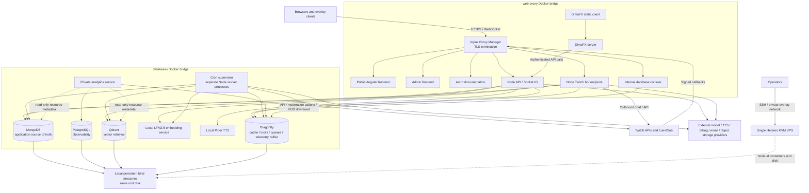

# DomDimaBot VPS Infrastructure Audit

## Executive summary and infrastructure health assessment

**Assessment: currently responsive, with substantial average CPU headroom, but meaningful storage, memory-isolation, and recovery risks. Downsizing is not established as safe.** This is an observation-only audit of the production VPS, conducted on **20 October 2026 UTC**, with production observations from **20:00 through 20:20**, with a final lifecycle check at **20:27:23** and the historical windows specified below. No application, database records, indexes, configuration, resource limits, or container lifecycle settings were changed. No benchmark or load test was run. The only deliverable is this report.

The host is a Hetzner KVM virtual server presenting 16 AMD EPYC-Rome vCPUs and **30.60 GiB of usable RAM**. Its exact commercial plan, price, physical-core allocation, storage SLA, and guaranteed network bandwidth were unavailable without account access. [H1]

The most consequential observations are:

- **Storage is the immediate capacity risk:** the root filesystem is **91% occupied**, with **28.42 GiB available**. The agent release-state directory alone occupies **109.60 GiB**; all inspected database bind directories together occupy **9.51 GiB**. This is not primarily a database-size problem. Nothing was deleted. [H1, H6]
- **Low CPU averages do not establish excess RAM:** seven-day average busy CPU was **4.59% of all 16 vCPUs**, but sampled unavailable memory reached **24.78 GiB**, and historical memory pressure includes severe episodes. The VPS has **no swap**. Current host/tool processes and `/tmp` tmpfs also materially affect headroom. [H1–H4]
- **Cron workers incur measurable process overhead:** the production cron tree contains **40 processes including its supervisor**, with approximately **2.85 GiB PSS** and **436 Linux tasks** at nearby snapshots. Workers are separate Node processes; domain-event handling adds another layer of consumer processes. This differs from an interpretation of “one cron host” as one shared application runtime. [H2, H3, W1]
- **Memory limits are uneven:** analytics and embeddings have CPU/memory limits, and the databases have memory caps; API, bot, cron, Piper, proxy, and frontends largely share unrestricted host resources. The embedding container has **three recorded restarts**, reached its **3 GiB memory ceiling**, and has a matching cgroup OOM event in the kernel journal. Other recent OOM events belong to removed containers and cannot be attributed to current production services. [H2–H5]
- **All stateful services are on the same VPS and root disk.** Containerization provides process/network separation, not host or disk redundancy. Automated off-host backups and tested data restoration were not demonstrated by the inspected schedules and source. Code rollback capabilities are documented and distinct from data recovery. [H5, N1, W1]

Additional confirmed findings are **338 steady application MongoDB connections, 306 from cron**, **209 Dragonfly dead-letter entries with no saved Dragonfly snapshot**, and analytics database physical growth of approximately **0.736 GiB/day**. Under unchanged current physical retention, PostgreSQL alone models to approximately **27.2 GiB at 30 days, 70.7 GiB at 90 days, and near 251 GiB at one year**; these are conditional short-baseline forecasts, not guaranteed consumption. OpenRouter errors are observed but their persisted categories do not establish VPS saturation. [M1, D1, P1, A1]

Database, traffic, pool, and growth findings are developed below. Recommendations distinguish observed problems from hypotheses and do not imply authorization to implement changes.

## Evidence conventions and scope

All timestamps are UTC. **GiB/MiB** use powers of 1024; **GB/MB** use powers of 1000. Percent CPU in Docker/process tables means **100% = one fully occupied vCPU**; host CPU percentages use all 16 vCPUs as the denominator. Historical sample peaks are not continuous-time maxima.

Evidence identifiers such as `[H1]` refer to the command/source register in the appendix. A timestamp/window stated above a table applies to every row in that table. Source-derived defaults are explicitly distinguished from measured effective settings. Live service binaries may be older than checkout source; runtime observations take precedence where they conflict.

Read-only inspection still consumes some CPU and adds transient database/client activity. The audit ran alongside host development/orchestration tools. A short instantaneous host CPU sample during inspection is consequently less representative than the pre-existing historical series. Ordinary read-only requests may increment server counters or produce normal access logs; no deliberate production data mutation was performed.

## Capacity and resource overview

| Resource | Provisioned/detected | Measured demand | Assessment |
|---|---|---|---|
| CPU | 16 virtual CPUs; AMD EPYC-Rome; KVM | 7d busy average 4.59%, p95 9.46%, maximum 10-minute interval average 20.03% | Considerable average headroom; burst and single-runtime constraints remain [H1, H4] |
| RAM | 30.60 GiB; no swap | 7d unavailable average 17.55 GiB, p95 18.72 GiB, sampled peak 24.78 GiB | RAM is a stronger constraint on downsizing than average CPU [H1, H4] |
| Application containers | 17 running | Docker working-set-like sum approximately 9.17 GiB at 20:00:54–56 | Excludes substantial reclaimable cache and host/tool/tmpfs use; not total host RAM [H2] |
| Processes | 499 process IDs at 20:00:54 | All-process PSS 13.51 GiB at 20:01:47; host/operator group 4.29 GiB at 20:02:53 | Process RSS sums overcount shared libraries; use PSS and host MemAvailable [H1, H3] |
| Temporary RAM filesystem | `/tmp` tmpfs capacity 15.30 GiB | 3.67 GiB allocated at 20:02:53 | Occupies real RAM on this swapless host; not included in ordinary process-PSS totals [H3] |
| Root storage | ext4, 300.08 GiB filesystem | 259.44 GiB used; 28.42 GiB available; 91% reported use | Immediate operational headroom concern; ext4 reserved space explains non-additive used/available totals [H1] |
| Inodes | 19,793,280 | 6,773,179 used, 35% | No current inode-exhaustion evidence [H1] |
| Storage I/O | One virtual non-rotational `/dev/sda` | 7d interval-average utilization 1.47%, p95 3.06%; sampled peak 18.64% | No sustained device-throughput saturation established; occasional stalls exist [H4] |
| Network | Virtual `eth0`; bandwidth entitlement unverified | 7d receive/send average 96.53/21.71 KiB/s; interval peak receive 35,387.34 KiB/s | No demonstrated sustained network bottleneck; provider limit unknown [H4] |

The four database engines serve distinct current roles. Memory columns below intentionally retain their measurement definitions; they are **not additive estimates of database RAM**.

| Database | Function | Selected measured memory | Physical footprint | Current connection/key/vector evidence |
|---|---|---|---|---|
| MongoDB | Application documents, ledgers and durable work | About 0.80 GiB process PSS at 20:02:53; 2 GiB WT cache ceiling | About 683 MB data directory at 20:07:12 | 338 application sockets, mostly worker pools [M1] |
| PostgreSQL | Private observability/telemetry | 278 MiB Docker display at 20:00:54; 2.60 GiB cgroup including cache at 20:01:47 | 5.191 GiB database at 20:20:13; WAL 144 MiB separately | Historical connections 1–6 / limit 100 [P1] |
| Qdrant | Semantic vector search and memory | 1.26 GiB exported resident at 20:13:30 | About 3.56 GB collection directories at 20:12:29 | About 623k vectors, two collections [Q1] |
| Dragonfly | Cache, queues, locks, sessions and telemetry buffer | 31.02 MiB key/server used memory, 72.41 MiB RSS at 20:13:30 | Empty persistence directory; no saved snapshot | 96,495 keys, 73 clients at 20:13:30 [D1] |

## Architecture and trust boundaries



Arrows describe source/runtime dependencies rather than a complete authorization audit. `databases`, `web-proxy`, and `dimafx_dimafx-internal` are ordinary Docker bridges with `Internal=false`; the last one's name does **not** mean Docker prevents external routing. There were respectively **11, 10, and 2 attached containers** at 20:02:30. Dual-attached application containers bridge access to otherwise un-published database ports. [N1]

The live reverse proxy has TLS and upgrade handling configured for public frontend, admin, docs, database console, API, bot endpoint, and proxy-management upstreams. API traffic routes internally to port 3000, bot callbacks to 3333, and static sites/console to port 80. DimaFX containers are attached to their own bridge and `web-proxy`, but no DimaFX upstream appeared among the seven inspected proxy-host configurations; external exposure through another mechanism was not established. [N1]

## 1. Host hardware, OS, utilization, and pressure

### Identity and instantaneous observations

The host reports **Ubuntu 26.04.1 LTS**, kernel **7.0.0-30-generic**, x86_64, Docker Engine **29.8.0**, a single guest socket, 16 guest cores and one guest thread per core. These describe the **virtual topology**, not 16 proven dedicated physical cores. DMI identifies **Hetzner / vServer**, and `systemd-detect-virt` identifies KVM. The advertised approximately 2.5 GHz clock is user-provided context; a guaranteed physical clock was not verified. [H1; 20:00:54]

At 20:00:54 the host had been up **40 days 13 hours 45 minutes**, with load averages **1.58 / 1.16 / 1.03** for 1/5/15 minutes. RAM was **32,853,925,888 bytes total** and **14,042,587,136 bytes available**. Swap capacity and use were both zero. Only 0.72 GiB was entirely free, but Linux can reclaim cache; low `MemFree` alone is not evidence of RAM exhaustion. [H1]

The five-second `mpstat` sample at **20:01:08–13** averaged **29.38% user + 7.20% system + 1.05% softirq**, **1.26% iowait**, **0% steal**, and **61.11% idle**. This audit-time burst is not representative of the seven-day workload. A separate process-delta sample at **20:04:26–29** accounted for approximately **6.30% of the host's total CPU**, including host/operator/audit activity. [H1, H3]

| CPU consumer in 20:04:26–29 process-delta sample | CPU, % of one vCPU |
|---|---:|
| Host/operator/audit tools, aggregate | 31.33 |
| Cron process tree | 28.06 |
| Local embeddings | 19.91 |
| MongoDB | 10.77 |
| Dragonfly | 3.92 |
| API | 3.59 |
| Proxy / bot | 1.31 each |
| Qdrant / analytics | 0.33 each |

This short sample excludes terminated processes not seen twice and is not a throughput benchmark or historical service ranking. Different sampled intervals account for differences from Docker's inventory snapshot.

### Historical metrics

Existing sysstat files were summarized without changing collection. The **24h** selection contains **144 samples** ending **2026-10-20 20:00:30**, first endpoint **2026-10-19 20:10:19**. The **7d** selection contains **1,008 samples**, first endpoint **2026-10-13 20:10:05**, ending at the same time. CPU/I/O/network values are interval averages, usually about ten minutes; RAM and load values are samples at collection. Maximum spacing was **629 seconds / 639 seconds** respectively. Interval means below are duration-weighted; percentiles use nearest-rank sample values and are not request-level percentiles. The first interval in each selection can begin shortly before the nominal selection boundary. [H4; extracted 20:02:04–30]

| Metric | 24h average | 24h p95 | 24h peak sample/interval | 7d average | 7d p95 | 7d peak sample/interval |
|---|---:|---:|---:|---:|---:|---:|
| Busy CPU excluding iowait/steal, host % | 5.59 | 11.22 | 16.38 | 4.59 | 9.46 | 20.03 |
| CPU iowait, % | 0.111 | 0.21 | 1.27 | 0.100 | 0.19 | 13.15 |
| CPU steal, % at available precision | 0 | 0 | 0 | 0 | 0 | 0 |
| Unavailable RAM, GiB (`MemTotal - MemAvailable`) | 16.52 | 17.52 | 24.78 | 17.55 | 18.72 | 24.78 |
| CPU PSI some, interval % | 0.602 | 0.99 | 6.31 | 0.528 | 0.68 | 9.49 |
| Memory PSI some, interval % | 0.005 | 0.03 | 0.18 | 0.389 | 0.01 | 86.05 |
| Memory PSI full, interval % | 0.005 | 0.03 | 0.18 | 0.373 | 0.01 | 81.71 |
| I/O PSI some, interval % | 0.178 | 0.37 | 1.48 | 0.152 | 0.33 | 15.65 |
| I/O PSI full, interval % | 0.169 | 0.36 | 1.41 | 0.144 | 0.32 | 14.59 |
| Disk utilization, % | 1.92 | 3.51 | 6.40 | 1.47 | 3.06 | 18.64 |
| Disk await, ms, mean of interval values | 0.72 | 0.99 | 1.20 | 0.64 | 0.99 | 2.95 |
| Disk read, KiB/s | 307.56 | 1,800.76 | 5,525.91 | 672.73 | 1,356.37 | 202,602.69 |
| Disk write, KiB/s | 1,020.06 | 2,589.98 | 5,916.62 | 1,120.74 | 2,589.98 | 137,451.16 |

Host load average 1-minute sampled mean/peak was approximately **1.09/19.58 (24h)** and **0.87/19.58 (7d)**; these arithmetic sample means are distinct from the weighted CPU means above. Seven-day p99 busy CPU was **13.76%**, unavailable RAM **21.34 GiB**, and disk utilization **6.05%**. [H4]

The largest in-window memory-pressure endpoint was **2026-10-17 19:00:00**: memory PSI some **86.05%** over its collection interval, with **8.81 GiB available** at the endpoint. This combination can reflect reclaim/cgroup contention that already subsided, not necessarily host-wide capacity exhaustion at that instant. The process/cgroup responsible was not established. Do not dismiss it because weekly average pressure was low. [H4]

### OOM evidence and memory accounting

`/proc/vmstat` recorded **133 OOM kills since boot** at 20:00:54. The kernel journal contained **39 actual “Killed process” records** in the seven days inspected at 20:03:35: **38 Node `MainThread` victims and one Python victim**. Corresponding OOM classification records were **CONSTRAINT_MEMCG**, indicating a cgroup limit, not a proven global host OOM. Kernel message lines were summarized; stack traces, addresses, and raw logs are excluded. [H1, H5]

One event at **2026-10-19 00:51:05** matches the current embedding container ID. The other **38** reference removed container IDs, whose service ownership cannot be confirmed from the live inventory. They may include historical/test workloads. The running containers' current `OOMKilled=false` fields and present cgroup counters do not erase prior process/container failures. Embeddings currently reports a memory peak exactly equal to its **3 GiB cap**, **699 limit-hit events**, three Docker restarts, and zero OOM kills in the current sampled cgroup counters; these counters have different lifecycle/reset boundaries. [H2, H3, H5]

At **20:02:53**, container process PSS was dominated by cron (**2.85 GiB**), embeddings (**2.13 GiB**), Qdrant (**1.23 GiB**), Piper (**0.95 GiB**), and MongoDB (**0.80 GiB**). Host/operator processes together used **4.29 GiB PSS**. `/tmp` tmpfs held **3.67 GiB**, including approximately **2.26 GiB** in browser/tool-classified temporary directories and **1.35 GiB** in other temporary directories; these labels are filename-based classifications, not proof of ownership or safe deletion. The tmpfs inventory was collected at 20:03:14. [H3]

**Do not add RSS, PSS, cgroup usage, tmpfs, and host used RAM together.** They overlap. PSS apportions mapped shared pages among processes; it omits unmapped page cache and unmapped tmpfs files. Docker's displayed memory subtracts much inactive file cache, whereas `memory.current` includes charged cache/kernel pages. For example, PostgreSQL's cgroup held **2.60 GiB** at 20:01:47, but about **2.33 GiB** was inactive file cache, yielding only about **278 MiB** in the earlier Docker display. Database file size is unrelated to that memory accounting. See [Docker runtime metrics](https://docs.docker.com/engine/containers/runmetrics/) for controller interpretation. [H2, H3]

### Disk, network, and process counts

`/dev/sda` is presented as a **305.2 GiB non-rotational virtual disk**; this does not prove dedicated SSD IOPS. Root ext4 reports **300.08 GiB capacity**, **259.44 GiB used**, **28.42 GiB available**, and **35% inode use**. `/var/lib/docker` is on that same filesystem. A one-second device sample at 20:01:14–15 showed **4.6–4.9% utilization**, write await **0.80–2.06 ms**, and read await **0–0.33 ms**. The first iostat report is since-boot, not a new interval; only subsequent intervals were used for these short-sample figures. [H1]

An idle-priority, time-bounded disk inventory completed **`/root/databases`: 10,207,752,192 bytes** and **`/root/.local/state/saas-ops`: 117,685,153,792 bytes**, then reached its 40-second timeout during later paths. No completed size is claimed for the remaining requested directories. The current checkout's release-state directory contained **909 subdirectories** at 20:03:35; this includes run/artifact entries, not 909 proven live releases. Release backups/receipts intentionally persist after helper cleanup. [H6, R1]

Docker's metadata/storage report at **20:01:08–approximately 20:01:30** showed **408 images / 22.24 GB**, **17 containers / 140.2 MB writable layers**, **3 volumes / 840.3 MB**, and **1,062 build-cache entries / 22.02 GB**. Docker marked **3.722 GB image space** and **14.78 GB build cache** reclaimable. Shared layers/cache can overlap: these totals must not be added as independently recoverable space. Bind-mounted database data and release-state artifacts are outside the volume total. No image, cache, or artifact was removed. [H6]

| `eth0` throughput, existing sysstat | Mean receive/send | p95 receive/send | Maximum interval receive/send |
|---|---|---|---|
| 24h ending 20:00:30 | 45.03 / 19.09 KiB/s | 99.37 / 62.85 KiB/s | 328.05 / 159.70 KiB/s |
| 7d ending 20:00:30 | 96.53 / 21.71 KiB/s | 83.61 / 113.19 KiB/s | 35,387.34 / 1,250.28 KiB/s |

The mean can exceed p95 when rare transfers dominate. These are interface interval rates, not upstream capacity measurements. At **20:01:47**, `eth0` counters showed **213,852,019,956 received bytes**, **75,889,944,114 transmitted bytes**, and **zero RX/TX errors or drops** since that interface's counter initialization. Docker bridge/veth traffic was not summed with external interface traffic, to avoid counting each internal transfer multiple times. [H3, H4]

There were **499 process IDs** at 20:00:54. Sysstat's `plist-sz` is a task/thread count and is therefore much higher: its seven-day sampled mean was approximately **2,082 tasks**, sampled peak **2,769**. Host namespace `ss -s` at 20:01:08 showed **36 established TCP connections**; this excludes separate container network namespaces and is not the application's total WebSocket or database connection count. [H1, H4, N1]

## 2. Docker production inventory and isolation

Inventory snapshot: **20:00:54–56 UTC**, `docker inspect` and `docker stats --no-stream`. Uptime is elapsed from inspected `StartedAt`, rounded. PIDs in this table are Linux tasks, including threads. “Host shared” means no container-specific memory cap; Docker displaying host RAM as a limit does not imply reservation. CPU is a brief sample. [H2]

| Container | Purpose | CPU % | Memory working-set-like display | Memory limit | PIDs | Restarts | Uptime |
|---|---|---:|---:|---|---:|---:|---|
| dima-server | HTTP API and Socket.IO | 1.77 | 176.7 MiB | Host shared | 11 | 0 | 1h58m |
| dima-bot | Twitch chat and callback endpoint | 1.93 | 155.8 MiB | Host shared | 11 | 0 | 1h59m |
| dima-cron | Worker supervisor and child processes | 28.15 | 2.894 GiB | Host shared | 436 | 0 | 1h59m |
| dima-analytics | Private telemetry ingestion/query/collectors | 0.35 | 59.16 MiB | 512 MiB | 11 | 0 | 6d14h26m |
| dimafx-server | Extension backend | 0 | 30.77 MiB | Host shared | 18 | 0 | 19d22h03m |
| dimafx | Extension static client | 0 | 13.54 MiB | Host shared | 17 | 0 | 40d11h51m |
| dimadocs | Documentation nginx | 0 | 15.23 MiB | Host shared | 17 | 0 | 40d11h51m |
| dima-admin | Admin frontend nginx | 0 | 13.96 MiB | Host shared | 17 | 0 | 40d11h51m |
| dimabot-site | Public frontend nginx | 0 | 14.96 MiB | Host shared | 17 | 0 | 40d11h51m |
| dimadb | Database console | 0 | 33.88 MiB | Host shared | 11 | 0 | 40d11h56m |
| lfm2.5-embeddings | Python/local embedding model | 4.77 | 2.148 GiB | 3 GiB | 27 | 3 | 1d19h10m |
| piper-tts | Python/local voice synthesis | 0.01 | 976.6 MiB | Host shared | 47 | 0 | 40d12h17m |
| postgres | PostgreSQL/analytics persistence | 0.53 | 278 MiB | 4 GiB | 8 | 0 | 40d12h24m |
| qdrant | Vector persistence/search | 0.26 | 1.138 GiB | 6 GiB | 94 | 0 | 40d12h24m |
| mongodb | Application documents and durable jobs | 27.91 | 985 MiB | 5 GiB | 390 | 0 | 40d12h24m |
| dragonfly | Cache/queue/coordination store | 4.69 | 77.87 MiB | 4 GiB | 22 | 0 | 40d12h24m |
| NPM | TLS reverse proxy and management UI | 0.22 | 226.9 MiB | Host shared | 39 | 0 | 40d13h25m |

Restarts count the current Docker object, not lifetime service failures. API/bot/cron had recently been recreated; zero restarts does not establish long-term reliability.

### Limits, health, and restart policies

At the same inventory snapshot, **all containers had empty CPU affinity masks**, and no explicit CPU shares or legacy quota/period settings. Only **embeddings (6 vCPUs)** and **analytics (1 vCPU)** had NanoCPU quotas. All memory reservations were zero except **embeddings (1 GiB)**. Only analytics had an explicit PID limit, **128**. The capped containers' memory limits total **22.5 GiB**, but these are ceilings, not allocated/committed memory, and do not reserve space against uncapped services. [H2]

| Group | Healthcheck | Restart policy | Cgroup memory peak at 20:01:47 |
|---|---|---|---|
| API / bot / cron | None | always | 337 / 281 MiB / 4.95 GiB respectively |
| Analytics | Healthy, 30s interval, 3 retries | unless-stopped | 140 MiB |
| Embeddings | Healthy, 15s interval, 5 retries | always | 3.00 GiB |
| Piper | None | always | 994 MiB |
| MongoDB | Healthy, 15s interval, 5 retries | unless-stopped | 2.19 GiB |
| PostgreSQL | Healthy, 15s interval, 5 retries | unless-stopped | 3.47 GiB |
| Qdrant | Healthy, 15s interval, 5 retries | unless-stopped | 4.46 GiB |
| Dragonfly | Healthy, 15s interval, 5 retries | unless-stopped | 91.6 MiB |
| Proxy | Healthy, 10s interval, 5 retries | unless-stopped | 1.08 GiB |
| Static sites / dimadb / extension backend | None | unless-stopped | Small; no functional readiness implied |

Peaks have **different start/reset times**, include page cache, and are not simultaneous; summing them would overstate a measured host peak. Conversely, current working sets underestimate build/reload/indexing peaks. An unhealthy Docker healthcheck alone does not automatically restart a process; the configured restart policy principally handles process exit. [H2, H3]

### Persistent mounts, ownership, dependencies, and logs

The live ownership labels confirmed Compose projects rather than assuming checkout paths. API/bot/cron, analytics, and extension backend currently use `saas-ops` generated release Compose files under private release-state paths; the database services belong to **`/root/databases/docker-compose.yaml`**, and NPM to **`/root/network/docker-compose.yaml`**. Frontend ownership maps to each project's own Compose file. Resolved private release files were not dumped. [H2]

| Service/group | Persistent host location or Docker volume | Purpose / access |
|---|---|---|
| MongoDB | `/root/databases/mongo_data` → `/data/db`; `/root/databases/dima_mongo` → `/dima_mongo`; anonymous configdb volume | Read/write data and auxiliary mount; second mount's active backup role unverified |
| PostgreSQL | `/root/databases/postgres_data` | Read/write database/WAL |
| Qdrant | `/root/databases/qdrant_data` | Read/write vector storage |
| Dragonfly | `/root/databases/dragonfly_data` | Read/write persistence directory; directory alone does not prove persistence enabled |
| Embeddings | Docker volume `dimabot_lfm2-embeddings-data` → `/data` | Model/cache files |
| Piper | Docker volume `dimabot_piper-data` → `/voices` | Voice models |
| dimadb | `/root/saas/dimadb/data` → `/data` | Console-local state |
| Public frontend | `/root/saas/dimasite/dist/dimasite/browser` and nginx config | Read-only published bundle/config mounts |
| Admin | `/root/saas/admin/dist/admin/browser` and nginx config | Read-only published bundle/config mounts |
| Docs | `/root/saas/dimadocs/dist` and nginx config | Read-only published bundle/config mounts |
| DimaFX static client | `/root/saas/dimafx` and nginx config | Read-only container mount; editing host client source is immediately live |
| Proxy | `/root/network/data`; `/root/network/letsencrypt` | Read/write proxy configuration/certificates; no contents exported |
| API / bot / cron / analytics / extension backend | No persistent mounts in live inspect | Images are immutable release payloads; state belongs in dependencies |

Container logging is `json-file` throughout. Databases have **50 MB × 3 file rotation settings**, and embeddings **10 MB × 3**. The other **12 containers** had no rotation options in their effective inspected log configuration. Active log-file sizes below exclude rotated files and any application-managed/proxy logs. [H2; 20:00:54]

| Container | Active Docker log bytes | Container | Active Docker log bytes |
|---|---:|---|---:|
| API | 461,692 | Bot | 46,610 |
| Cron | 1,973,941 | Analytics | 0 |
| Extension backend | 1,461 | Extension static | 17,389 |
| Docs | 4,062,605 | Admin | 2,001,999 |
| Public frontend | 29,341,363 | dimadb | 193 |
| Embeddings | 9,653 | Piper | 248,654 |
| PostgreSQL | 1,030,019 | Qdrant | 41,979,766 |
| MongoDB | 37,853,335 | Dragonfly | 72,453 |
| Proxy | 508,414 | | |

No running container was privileged, and **no Docker socket was mounted**. Analytics runs as `node`, has a read-only root filesystem, drops all capabilities and uses `no-new-privileges`. Most other inspected containers use root/default user and writable root filesystems; effective process privilege may be lower where an entrypoint drops it, which was not exhaustively audited. None had a custom OOM score or OOM-kill protection. [H2; security fields observed 20:03:24]

Only NPM publishes Docker host ports: **80, 443, and management port 81**, on both wildcard IPv4 and IPv6. SSH **22** also listens publicly. The host firewall's UFW status was inactive and `DOCKER-USER` had no filtering rules; upstream/cloud firewall protection was not verified. Management port 81 therefore merits exposure review, but public reachability from outside the VPS was not probed. Database ports were container-only. Host private-overlay/loopback listeners exist; addresses and private network details are intentionally omitted. [N1]

## 3. Application processes and worker architecture

### Runtime and failure model

The cron runtime is **Node.js v24.22.0**, confirmed with `node --version` inside the live container. Its supervisor registers **26 worker definitions**, starts them with `child_process.spawn`, and inherits their logs. It does not implement workers as `worker_threads` or logical functions sharing one heap. At the observed **20:02–20:04** process snapshots, **25 top-level workers** were present; EventSub reconciliation was absent. An allowlisted configuration check at **20:11:54** confirmed `EVENTSUB_RECONCILIATION_ENABLED=false`, explaining its absence. [W1]

Domain events creates an additional **14 observed consumer processes** under its supervisor. The source registry contains **14 consumer definitions**, matching the process table below. With the outer supervisor, cron held **40 processes** and about **436 tasks**. Individual workers commonly have **11 runtime threads**; those are not 11 independent JavaScript workers. [W1, H2, H3]

The supervisor retries an exited worker after a default **5 seconds**, without exponential backoff, and keeps restart counts in memory/logs. Thus Docker's cron restart count does not measure child failures. Simple polling workers sleep between passes and retain their own heaps, imported modules, clients, and pools while idle. Heavy VOD/model work can also spawn transient subprocesses not present in an idle snapshot. [W1]

### Per-process memory and sampled CPU

Measured from `/proc` in **20:02–20:04 UTC**, using two process-stat snapshots approximately **2 seconds** apart for CPU. RSS/PSS are MiB, rounded to one decimal; CPU excludes child accounting, uses one-core percentages, and has approximately 0.5 percentage-point tick granularity. All rows are in `dima-cron` and use Node; container PID is the final `NSpid` value. This is an observed process inventory, not a promise of idle or peak demand. [W1]

| Worker / consumer | Host PID | Container PID | RSS MiB | PSS MiB | CPU % |
|---|---:|---:|---:|---:|---:|
| Cron supervisor | 1384873 | 1 | 81.7 | 26.4 | 0.0 |
| dashboard-activity | 1384972 | 15 | 117.6 | 60.4 | 1.0 |
| raid-analytics | 1384973 | 16 | 109.5 | 57.8 | 1.5 |
| stream-activity | 1384974 | 17 | 100.5 | 48.6 | 0.5 |
| goals | 1384975 | 18 | 99.4 | 46.6 | 0.5 |
| duel | 1384976 | 19 | 172.5 | 117.4 | 0.5 |
| widgets | 1384977 | 20 | 99.5 | 46.8 | 0.5 |
| credit-gifts | 1384984 | 27 | 174.8 | 119.7 | 0.5 |
| semantic-moderation | 1384989 | 32 | 273.8 | 216.8 | 1.0 |
| roulette-actions | 1384995 | 38 | 95.0 | 43.4 | 0.5 |
| roulette-completion | 1385003 | 46 | 94.3 | 42.5 | 0.5 |
| follow-defense-baseline | 1385008 | 51 | 91.9 | 40.3 | 1.0 |
| raid-sessions | 1385013 | 56 | 95.5 | 43.6 | 1.0 |
| follow-defense-actions | 1385014 | 57 | 122.8 | 71.2 | 2.0 |
| follow-defense | 1385030 | 73 | 99.9 | 42.9 | 0.0 |
| follow-ledger | 1385031 | 74 | 102.1 | 43.6 | 0.5 |
| stream-analytics | 1385032 | 75 | 112.9 | 52.4 | 0.0 |
| Domain-events supervisor | 1385052 | 95 | 99.1 | 47.0 | 2.0 |
| free-credit-reset | 1385062 | 105 | 163.3 | 104.7 | 0.0 |
| AI-usage receipts | 1385069 | 112 | 177.5 | 117.4 | 0.5 |
| AI-usage backfill | 1385082 | 125 | 201.7 | 139.7 | 0.0 |
| stream-memory | 1385096 | 139 | 196.4 | 135.5 | 0.0 |
| temporary-roles | 1385097 | 140 | 172.3 | 113.8 | 1.0 |
| timer | 1385101 | 144 | 182.1 | 121.3 | 0.5 |
| activation-reminder | 1385107 | 150 | 114.1 | 55.5 | 0.5 |
| VOD clip recommender | 1385111 | 154 | 179.7 | 121.5 | 0.5 |
| Consumer: raid-history-v1 | 1385235 | 227 | 105.1 | 47.5 | 1.0 |
| Consumer: stream-timeline-v1 | 1385236 | 228 | 114.8 | 56.1 | 1.0 |
| Consumer: channel-goals-v1 | 1385248 | 238 | 110.7 | 52.1 | 1.5 |
| Consumer: widget-actions-v1 | 1385249 | 239 | 111.5 | 53.2 | 1.0 |
| Consumer: overlay-interactions-v1 | 1385251 | 241 | 98.1 | 46.1 | 0.5 |
| Consumer: follow-defense-v1 | 1385256 | 246 | 105.3 | 47.5 | 1.5 |
| Consumer: stream-analytics-v1 | 1385268 | 258 | 111.6 | 52.7 | 1.5 |
| Consumer: stream-operations-v1 | 1385270 | 259 | 114.5 | 53.5 | 1.0 |
| Consumer: chat-announcements-v1 | 1385271 | 260 | 188.0 | 126.3 | 2.5 |
| Consumer: account-health-notifications-v1 | 1385278 | 267 | 178.5 | 117.7 | 0.5 |
| Consumer: polar-plan-v1 | 1385288 | 277 | 97.3 | 45.3 | 1.0 |
| Consumer: polar-credits-v1 | 1385289 | 278 | 107.1 | 49.3 | 1.0 |
| Consumer: polar-rewards-v1 | 1385291 | 280 | 96.7 | 44.9 | 1.0 |
| Consumer: polar-gifts-v1 | 1385298 | 287 | 97.7 | 45.7 | 0.5 |

All ordinary worker/consumer rows had 11 threads; the outer supervisor had seven. API, bot, analytics and extension-backend container init PIDs were respectively **1387868, 1386917, 1325728, 1101823** at 20:00:54; an init PID may be an entrypoint wrapper rather than the application process. Their container-level CPU/memory figures are in section 2. API/bot are separate Node runtimes; analytics collectors and retention run as logical timers in the analytics service rather than separate collector processes. Piper and embeddings are separate Python processes/services. [H2, W1, A1]

### Responsibilities, cadence, queues, and active/idle behavior

The following are **checkout source defaults**, audited on 20 October, except where an effective setting is explicitly identified; secret-bearing environment fields were not exported. A single worker may combine several schedules. Each row has its own process unless described as a nested consumer. Full source paths are listed under W1. [W1]

| Worker | Responsibility / scheduler dependency | Cadence and work limits | Failure/retry behavior |
|---|---|---|---|
| Dashboard activity | Mongo event projection/activity insights | Batches 500; sleeps 1s when idle | 40s watchdog; catches tick errors |
| Raid analytics | Raid projection | Sequential 1s loop | Logs and continues |
| Stream activity | Stream-event projection | Batches 500; 1s idle sleep | Fatal outer error restarts process |
| Goals | Settle deadlines | 5s polling | Repeated due-work polling |
| Duel | Settle duels/restore roles/announce | 500ms polling | Queue/effect handling in helpers |
| Widgets | Draw deadlines and Twitch polls | 1s polling | Repeated due-work polling |
| Credit gifts | Durable Mongo credit-gift jobs | Single job; 1s delay | 90s watchdog before lease expiration |
| Semantic moderation | Mongo semantic decisions/variation jobs; Dragonfly budget counters | Four decision tasks plus one variation task; maintenance 1s | Decision errors finish uncertain/unavailable; variation failures mark failed and can be requested again |
| Roulette actions | Due winner effects | Sequential 1s polling | Durable/repeated action processing |
| Roulette completion | Settle deadlines | 1s polling | Repeated due-work polling |
| Follow-defense baseline | Baseline refresh | Sequential 1s polling | 30s watchdog; continue on tick errors |
| Raid sessions | History/retention/backfill/moderation requests | Sequential 1s loop | 40s watchdog |
| Follow-defense actions | Durable moderation actions/reconciliation | One per tick; 20ms busy sleep, adaptive idle pacing | 60s lease; 40s watchdog |
| Follow defense | Follow-event work, mode expiry, summaries | Global lock; 1s tick; lock retry 5s | Lock/lease recovery |
| Follow ledger | Queue requests, daily follower synchronization | Blocking pop up to 5s; API pacing 1s; writes 250 | Channel/daily locks; startup sweep off by default |
| Stream analytics | Live-session reconciliation/viewer snapshots | Every 5m, startup run enabled | Global lock, sequential snapshot operation |
| Domain events | Durable Mongo event dispatch; Redis hints | Dispatch batches 100; 14 consumer processes poll 1s | Five attempts; 60s lease; 120s execution timeout; child watchdog/restart |
| EventSub reconciliation | Subscription reconciliation | 6h; startup run off; 3h lock | Disabled in effective environment (checked 20:11:54) |
| Free credit reset | Eligible credit resets | Hourly; bounded batches | Global lock heartbeat |
| AI usage receipts | Redis receipts → Mongo metering | Up to 200/pass; 1s idle; health poll 10s | Processing-list reclaim on startup |
| AI usage backfill | Polar usage synchronization | Daily UTC sweep; sequential jobs; 1s external request delay | Three attempts then dead letter |
| Stream memory | Offline summaries, weekly/monthly maintenance | Blocking pop 5s; one workflow; channel/global locks | Three attempts, retry 2.5s, dead letter |
| Temporary roles | Expire VIP/mod roles and announce | 60s; batches 100 | Failed effects retried/logged |
| Timer | Active-channel due timers / claim recovery | At least 60s cadence; recovery every 2s | Global lock and expired-claim handling |
| Activation reminder | Reminder emails | Daily UTC; startup sweep; batches 50 | Lock and per-recipient error handling |
| VOD clips | Twitch VOD fetch, analysis/recommendation, recovery | One workflow; blocking pop 5s; reconcile 15m | Two attempts, 24h stale expiry, recovery/dead letter |

Domain consumers own account-health notifications, goals, announcements, follow defense, overlays, Polar plans/credits/gifts/rewards, raid history, stream analytics, stream operations/timeline, and widgets. They are isolated processes, not a pool dynamically allocated only when there is work. [W1]

### Is runtime overhead excessive?

**There is confirmed duplication; waste cannot be measured precisely from RSS alone.** Lower-footprint cron children have approximately **40–60 MiB PSS** each, while feature-heavy ones reach approximately **120–217 MiB** in this snapshot. PSS includes useful application state, libraries, module graphs, client buffers and runtime; it does not distinguish useful state from overhead. No heap dump, process restart experiment or application mutation was permitted. Consequently no exact “wasted MiB” or guaranteed consolidation saving is claimed. [W1]

The many idle/sequential projection and deadline workers are reasonable **candidates for a bounded shared scheduler/runtime**, provided failure isolation, watchdogs, idempotency, fair scheduling and pool limits are preserved. Domain consumers are another candidate for a bounded process pool. Keep VOD extraction, local inference and latency-sensitive moderation isolated until measured: they have materially different failure/CPU/memory behavior. Consolidation would require code changes and careful isolated verification; none was attempted. [W1]

Source instruments heap, CPU, and event-loop telemetry at **10-second process sampling when telemetry is enabled** in `utils/observability/telemetry.ts`. Exact current heap cannot be inferred from OS RSS, and aggregate process metrics must preserve the process label to avoid summing unrelated heaps. Durable worker restart counts are not uniformly available; the kernel and container snapshots cannot reconstruct a complete per-worker failure history. [W1]

## 4. MongoDB: workload, pools, indexes, and recovery

### Live metadata and workload

MongoDB is **8.2.6, standalone WiredTiger**, with authentication enabled and no replica-set/oplog recovery path established. The container started **2026-09-10 07:36:46**. Metadata was collected at **2026-10-20 20:07:12–13**, with connection checks at **20:11:15–17** and cache/rate verification at **20:16:50–20:17:17**. No collection scan, query explain, profiler activation or data export was performed. [M1]

| Item | Observation |
|---|---|
| Container memory cap | 5 GiB |
| WiredTiger configured cache | 2,147,483,648 bytes = 2 GiB |
| Cache at 20:17:17 | 367,120,310 bytes = 350.1 MiB; dirty 32,099,965 bytes = 30.6 MiB |
| Resident memory | Server counter 820–823 reported MB during audit; OS process PSS about 0.80 GiB at 20:02:53; cgroup includes additional kernel/cache pages |
| Cache eviction counters at 20:17:17 | Modified pages evicted 100,221; unmodified 169, cumulative since counter reset |
| Compression | `snappy` confirmed in sampled WiredTiger collection creation metadata |
| Global lock queue | 0 at the metadata sample |
| Profiler / slow threshold | Profiler off; `slowms=100`; no complete slow-query census available |
| TTL monitor since startup | 58,346 passes; 473,621 document deletions; zero invalid skips |
| Database files | Mongo data directory approximately 683 MB at 20:07:12; not equivalent to logical document size or RAM |

The cache ceiling is consistent with a cgroup-aware default of half of memory above 1 GiB. At the measured workload it is far from full. Lowering the Docker cap is therefore not an immediate reclamation of 5 GiB; actual memory use and cache behavior matter. [M1]

At **20:16:50.370–20:16:53.394**, a **3.024-second** `serverStatus` delta measured **82.34 queries/s, 25.79 updates/s, 0 inserts/s, 0.66 deletes/s, 0.33 getMores/s, and 40.67 commands/s**. Commands include monitoring/audit traffic; these are not business requests per second. Since startup, sampled counters at 20:07:12 were **148,074,387 queries, 50,546,019 updates, 426,881 inserts, 220,715 deletes, and 74,314,388 commands**. Lifetime server-side operation means were approximately **440 µs reads, 587 µs writes, 157 µs commands**. These means are not query p95/p99 and exclude application queue/pool/network time. [M1]

Existing resource telemetry covers almost seven days ending **20:06:18**: Mongo connection samples ranged **33–351**, with last **338** and 24h mean approximately **340**. Cache ranged approximately **278–378 MB**, resident memory **655–864 MB** in that collector's byte-normalized units. Logical application data rose from approximately **248 to 319 MB**. Collection-level daily storage/index growth and historical query-tail latency were not retained in the inspected resource series. [A1]

### Database and collection sizes

At **20:07:12–13**, `domdimabot` had **96 collections**, approximately **594,685 documents**, **319 MB logical data**, **104 MB allocated collection storage**, and **134 MB indexes across 357 indexes**. Three other user databases collectively had **717 documents**; together all inspected user databases had **105 collections**, approximately **320 MB logical data**, **105 MB collection storage**, and **134 MB indexes**. Their names and records are unnecessary for this report. Counts use metadata estimates, not document scans. [M1]

| Larger application collection | Approximate documents | Logical MB | Allocated storage MB | Index MB / count | TTL metadata |
|---|---:|---:|---:|---|---|
| follow_relationship_ledgers | 145,830 | 53.6 | 14.9 | 27.1 / 11 | No TTL index found |
| channelstreamsummaries | 9,251 | 27.2 | 14.2 | 1.8 / 10 | No TTL index found |
| domain_events | 39,419 | 52.5 | 13.0 | 12.9 / 13 | Date-field expiry |
| domain_event_deliveries | 87,225 | 49.6 | 11.3 | 16.4 / 9 | Date-field expiry |
| streamviewersnapshots | 141,966 | 46.8 | 9.8 | 10.1 / 7 | No TTL index found |
| ai_usage_receipts | 47,339 | 25.3 | 9.7 | 27.4 / 10 | Date-field expiry |
| stream_activities | 36,368 | 12.9 | 7.1 | 15.4 / 7 | Date-field expiry |

Logical/allocated collection data is roughly **3.1:1** at database level, consistent with compression, but this is **not** a pure compression ratio: allocation slack, engine metadata, and compression all affect it. Indexes exceed compressed collection storage; this is a more relevant tuning opportunity than assuming the database is multi-gigabytes of resident documents. [M1]

Existing `$indexStats` metadata covered **377 indexes across the inspected databases**. **136 non-`_id` indexes had zero recorded operations** in their available counter window. Examples: clip recommendations **13/16**, extension items **9/12**, media assets **8/12**, stream summaries **7/10**, subscription ledgers **7/11**. Counters are scoped to each index's lifetime/reset, often since the September startup; newly created indexes can have shorter windows. Zero observed reads does not prove an index is unnecessary: uniqueness, TTL, rare admin paths and recovery queries must be checked before any removal. [M1]

Date-field TTL indexes commonly use `expireAfterSeconds=0`; that means expiry at the document's expiry timestamp, not immediate deletion of every new document. Source sets domain-event retention by topic (channel/domain **90 days**, activity **3 days**, telemetry **7 days**) and AI usage windows by plan (**30/60/90 days**). Moderation action logs have a **30-day** TTL. Viewer snapshots, follow ledgers and stream summaries have no observed age TTL and can grow with history. No record was inspected to establish actual oldest-document age. [M1]

### Why approximately 338 connections exist

**The count is explained principally by one independent pool per worker process, not three full 100-connection service pools.** At **20:07:12.483**, `connections.current=340`, including **two audit-client sockets**. The following attribution was independently matched to process socket metadata at **20:11:15**. Internal addresses are omitted. [M1]

| Application/container | Established Mongo sockets | Client processes | Interpretation |
|---|---:|---:|---|
| dima-cron | 306 | 39 of 40 processes | Outer supervisor has none; workers/consumers each own clients |
| dima-server | 16 | 1 | API pool plus monitor sockets |
| dima-bot | 12 | 1 | Bot pool plus monitor sockets |
| dima-analytics | 4 | Two configured clients within one service | Small explicit monitoring/name-resolution pools |
| dimadb | 0 | No connected Mongo client at sample | On-demand console access is not persistent in this snapshot |
| **Application total** | **338** | | |

Server counters at 20:07:12: **43 active, 25,873 available, 928,035 total created, zero rejected**, **42 streaming hello connections**, and **42 awaiting topology changes**. “Active” includes monitoring work; it does **not** mean 43 expensive application queries. `current+available=26,213` describes reported connection capacity at that moment, not a safe performance target. Existing seven-day sampled peak was **351**, not an all-time continuous maximum. [M1, A1]

The default Mongoose helper caches a connection promise **inside each process**. Running driver metadata was **MongoDB Node driver 6.20.0 / Mongoose 8.24.2**, with Node **24.22.0**; checkout dependencies report a slightly newer driver, so live metadata takes precedence. Both reviewed defaults and the official driver reference give **maxPoolSize=100**, **minPoolSize=0**, **maxIdleTimeMS=0**, **maxConnecting=2**, and an unbounded default checkout wait timeout. An allowlisted URI-parameter check found **no pool overrides** in the API/bot/cron connection settings; no URI or credential values were exported. [M1; [driver pool reference](https://www.mongodb.com/docs/drivers/node/current/connect/connection-options/connection-pools/)]

There are **41 default-pool processes** (39 cron, API, bot). Monitoring adds approximately two sockets/client; analytics adds small separately configured clients. A plausible decomposition is approximately **252 application-pool sockets + 86 monitoring sockets = 338**; the direct per-process established-socket count is stronger evidence than that approximate role decomposition. Analytics source caps its clients at **2 and 1 pooled connections** with **3,000/1,500 ms socket timeouts**. [M1]

Cron per-process socket distribution at **20:11:15** was **13 sockets × 5 processes; 12×1; 10×2; 9×3; 8×4; 7×16; 6×3; 5×1; 4×3; 3×1**, totaling **306**. Examples: timers/duels/credit gifts/announcement consumers had 13 each; semantic moderation and VOD had eight each; activation reminders had three. Subtracting monitor sockets, current worker pools are small, approximately **1–11** application connections each, rather than 100. [M1]

Between **20:07:12 and 20:11:17**, total-created rose **66** in approximately **245 seconds**, while current stayed at 340 including the audit client: about **0.27 new connections/s**. This demonstrates churn during a stable-count interval, not an observed growing connection leak. Because idle timeout is zero, default clients can retain demand-driven high-water marks until errors/disconnects/process exit. If all 41 pools grew to their default ceiling, their pool-only budget would approach **4,100 sockets**, plus monitoring. No measured per-socket RAM cost is available, so no invented GiB saving is attached. Explicit worker-specific pool and wait/idle budgets are reasonable optimization candidates; validate checkout latency before reducing them. [M1]

### Mongo recovery evidence

No replica or continuously archived oplog was established. The auxiliary `/root/databases/dima_mongo` mount was empty. A local archive from **2026-09-10 07:59 UTC**, approximately **15.5 MB**, exists with checksum/restore-log file metadata. Its presence is historical evidence of a dump/restore activity, **not proof of a current successful restore, completeness, off-host retention or an automated schedule**. The manual backup script does not establish those capabilities. [M1, W1]

## 5. PostgreSQL analytics: physical growth is the main database risk

### Version, connections, cache, WAL, and query statistics

The analytics database is `observability` on **PostgreSQL 17.8**, postmaster started **2026-09-10 07:36:47**. Catalog inspection at **20:03:07** measured **5,560,932,019 bytes = 5.179 GiB**; resource telemetry at **20:06:18** measured **5.181 GiB**. An independent read-only check at **20:20:13** measured **5,574,162,099 bytes = approximately 5.191 GiB**. This verifies the earlier approximately **5.17 GiB** dashboard size. [P1]

| Setting/statistic | Observation and interpretation |
|---|---|
| Docker cap / current memory | 4 GiB cap; earlier Docker display 278 MiB versus cgroup 2.60 GiB largely charged file cache; not 5.18 GiB RAM [H2, H3] |
| shared_buffers | 128 MB |
| effective_cache_size | 4 GB planner estimate, not allocated RAM |
| work_mem / maintenance_work_mem | 4 MB per eligible operation / 64 MB; work_mem is not a global memory ceiling |
| max_connections | 100; seven-day observed connections 1–6; 24h mean 1.15; two current-db backends at 20:20:13 including audit |
| WAL / checkpoints | wal_level replica; max_wal_size 1 GB, min_wal_size 80 MB; wal_compression off; checkpoint_timeout 300s; completion target 0.9 |
| Autovacuum | On; vacuum scale factor 0.2, analyze scale factor 0.1 |
| I/O statistics | track_io_timing off; effective_io_concurrency 1; random_page_cost 4 |
| Transaction timeout | idle_in_transaction_session_timeout 0; audit SET LOCAL timeouts were session-only, not production config changes |
| Existing query-tail instrumentation | pg_stat_statements not installed in this database; log_min_duration_statement=-1; no database-wide slow-statement percentile available |
| Observability database cumulative counters | 2,345,234 commits, six rollbacks, zero deadlocks; 329 temp files totaling 3.93 GiB; reset timestamp null |
| Buffer hit ratio | Approximately 94.6% from 470.1M block hits / 26.7M reads; this is not query success rate |
| Replication / archive | No replication slots; archive_mode off; zero archived segments observed |

Settings/cumulative counters were collected **20:03–20:06**, with version/shared_buffers/extension/slow-log checks at **20:20:13**. Catalog queries did not select statement text or application records. [P1]

Instance-wide WAL statistics since **September 10** showed **52,791,851,614 generated bytes = 49.17 GiB**, approximately **1.21 GiB/day** over the instance's 40.5-day life, **166.9M records**, **5.98M full-page images**, and **571,779 wal_buffers_full events**. These are **not current disk usage** or observability-only WAL. Checkpointer counters showed **11,667 timed and one requested checkpoint**, **5,085,162 buffers written**. Whether cumulative buffer-full events are currently a bottleneck needs interval correlation; no latency claim is made from them alone. [P1]

The monitoring SQL role was denied `pg_ls_waldir()`. To fill that gap without elevating a database session, the audit read **immediate file metadata only** in the host's `pg_wal` directory at **20:20:13**: **nine regular files, 150,994,944 bytes = 144 MiB logical and allocated**. File names/contents were not exported. WAL retention can change with activity, checkpoints and replication; this is one snapshot. [P1]

A standalone query-per-second counter and historical query-duration distributions were not available. Ingestion receipts cover approximately **703,949 batches over 48.5 hours**, roughly **4 batches/s**. Transactions include ingestion, aggregates, collectors and reads, so batch rate is not database QPS. No long transaction was observed in the inspected activity snapshot. [P1, A1]

### Largest tables and indexes

Catalog metadata at **20:03:07** reported **5,554,528,256 bytes of table-related storage**, close to total database size. The daily **metrics partitions dominate**. Below, decimal MB includes heap/associated indexes; row and dead-tuple counts are catalog estimates. [P1]

| UTC partition day | Metrics MB | Estimated live metric rows | Estimated dead rows | Span MB | Resource MB |
|---|---:|---:|---:|---:|---:|
| Oct 13 | 135 | 65,997 | 0 | — | 1.9 |
| Oct 14 | 699 | 293,652 | 24,435 | — | 11.5 |
| Oct 15 | 730 | 302,265 | 30,829 | — | 11.5 |
| Oct 16 | 729 | 317,741 | 28,060 | — | 11.5 |
| Oct 17 | 785 | 359,930 | 29,199 | 45.5 | 11.5 |
| Oct 18 | 688 | 545,490 | 0 | 43.8 | 11.5 |
| Oct 19 | 792 | 1,886,554 | 42,289 | 50.9 | 11.5 |
| Oct 20, partial to 20:03 | 651 | 1,594,517 | 64,909 | 44.5 | 9.6 |

Empty future daily partitions also exist. `analytics_batches` occupied approximately **77.6 MB**, including **42.7 MB heap / 34.8 MB index**, for about **704k rows**. Grants/audit were only tens of KiB and had one live row each; no identities were read. Logs occupied under **1 MB**. [P1]

Index storage was dominated by the metrics primary key **`(resolution, at, service, kind, name, channel, outcome)`**, approximately **1.64 GB across 11 partitions**. Span indexes added approximately **48 MB trace lookup**, **31 MB channel/time lookup**, and **27 MB primary key**. Resource primary keys occupied about **33 MB**. Batches have an ID primary key but no `received_at` index. The latter is a potential retention-scan cost, not a demonstrated production bottleneck; any added index needs workload evidence and a separate migration. [P1]

### Retention works logically but leaves old daily files large

Source and live row mix agree: all three metric resolutions share daily time partitions; ingestion writes **10-second, 60-second and hourly** aggregates. Retention deletes **10s rows after 2 days**, **60s rows after 30 days**, but retains each metrics partition for **365 days** to preserve hourly data. Spans/logs/resources are retained **3/7/30 days**, receipts **2 days**, audit **365 days**. [P1; `src/store.mjs:90–103`]

The physical-storage implication is significant. On Oct 19, approximately **1.55M ten-second rows**, **323,774 minute rows** and **13,402 hourly rows** were written. Minute/hourly resolutions represented the **same 17,837,406 underlying observations**, so they must not be added as separate traffic. After fine rows age out, autovacuum removes dead tuples for reuse, but normally does not return an old immutable partition's interior free space to the filesystem. Old Oct 14–17 partitions still occupy **699–785 MB** with only **294k–360k live rows**, versus **792 MB / 1.89M live rows** on Oct 19. That is strong evidence of retained allocation, not evidence that autovacuum stopped working. [P1]

Autovacuum had run on old partitions approximately one to two days after their day, leaving tens of thousands rather than millions of estimated dead tuples. No manual vacuum was recorded in inspected counters. Exact bloat percentages require additional measurement and were not obtained; the audit did not run `VACUUM`, `ANALYZE`, `pgstattuple`, a table rewrite or index maintenance. [P1]

### Observed growth and forecasts

Existing `postgres.database_bytes` samples, approximately every **30 seconds**, cover **2026-10-13 20:08 to 2026-10-20 20:06**. Decimal units below are as summarized from that series; Oct 13 and Oct 20 are partial days. [P1, A1]

| Day | First → last size | Gain versus previous day-end |
|---|---|---:|
| Oct 13, partial | 8.4 → 158 MB | Partial |
| Oct 14 | 158 → 940 MB | 782 MB |
| Oct 15 | 0.940 → 1.753 GB | 813 MB |
| Oct 16 | 1.754 → 2.548 GB | 794 MB |
| Oct 17 | 2.548 → 3.384 GB | 836 MB |
| Oct 18 | 3.384 → 4.086 GB | 702 MB |
| Oct 19 | 4.086 → 4.898 GB | 812 MB |
| Oct 20 to 20:06 | 4.898 → 5.563 GB | 666 MB in approximately 20.1h |

The six full day-end increments average **790,044,672 bytes/day = 753 MiB/day = 0.736 GiB/day**. This is **physical net growth**, not just ingestion payload volume. Resource partitions contribute approximately **11.5 MB/day** and begin cycling at their 30-day retention cap in November; spans already cycle. The following forecasts anchor at **5,563,348,659 bytes on Oct 20 20:06:18**, assume unchanged series cardinality/traffic/index representation and effective existing retention, and exclude WAL, backups, temporary operations, other databases and release artifacts. [P1; model calculated Oct 20]

| Horizon from Oct 20 | Conditional database footprint | Assumption / limit |
|---|---:|---|
| 30 days, Nov 19 | **Approximately 27.2 GiB** | About 23 days at 790 MB/day, then 7 at 778.5 MB/day after resource retention cycles |
| 90 days, Jan 18 2027 | **Approximately 70.7 GiB** | Same physical growth pattern, resources capped |
| 365 days, Oct 20 2027 | **Near approximately 251 GiB physical plateau** | Around 365 large daily metric partitions retained, plus cycling resources/spans/receipts; full retention cycle not yet observed |
| 365-day no-partition-drop sensitivity | **Approximately 274 GiB** | Current growth rate continued without effective partition reclamation; not the expected retained design |

The plateau model uses mean full-day metric-partition allocation **737,079,296 bytes × 365**, plus roughly **345 MB resources, 184 MB span partitions and 78 MB batch storage**. First metric partition drops should begin around **mid-October 2027**, subject to end-of-day and retention-task timing. Six full days is a short baseline: seasonality, added channels, instrumentation changes and cardinality can materially change these values. [P1]

A logical retained-row model would be much smaller: approximately **17.7M rows** at roughly **420 bytes per current live row**, around **7.4 GB**, if physical layout/retention kept only the intended resolution windows compactly. That is a **design sensitivity**, not the running system's footprint, a promised compaction result, or a recommendation to rewrite live tables. Splitting retention/storage by resolution is a candidate migration to evaluate. [P1]

With only **28.42 GiB** available at the host baseline, the modeled next 30 days add about **22 GiB from this database alone**, before Qdrant, artifacts and logs. This is a concrete reason to address storage lifecycle now. A year-scale approximately 251 GiB analytics database is incompatible with assuming the current 300 GiB root filesystem has unlimited spare capacity. [H1, P1]

## 6. Qdrant vector database

Version **1.17.0**, container memory cap **6 GiB**. Collection/metric inspection at **20:13:30** found approximately **623k vectors**, **1.26 GiB exported resident memory**, **1.21 GiB active allocator memory** and **2.51 GiB retained allocator memory**. These allocator/cgroup/process counters differ and must not be added. This independently matches the earlier dashboard's vector/resident observation. The Docker working-set-like snapshot earlier showed 1.138 GiB. [Q1, H2]

| Collection/configuration at 20:13:30 | twitch_chat_logs | twitch_channel_memories |
|---|---:|---:|
| Point count | 619,113 | 4,351 |
| Indexed vector count | 617,543 | 0 |
| Segments | 8 | 8 |
| Vector dimensions / distance | 1,024 / Cosine | Same |
| Original vectors | On disk; no explicit datatype override (default Float32) | Same |
| Quantization | Scalar int8; quantile 0.99; quantized copy always in RAM | Same |
| HNSW | m=16; ef_construct=100; index in RAM | Same |
| Full-scan / indexing threshold | 10,000 / 10,000, in vector-size KB units | Same |
| Payload storage | On disk; indexed values also require index memory | Same |
| Shards / replication / consistency | 1 / 1 / 1 | Same |
| Collection status / optimizer | Green / OK | Green / OK |
| Running optimizations / update queue | Zero at sample | Zero at sample |
| Collection snapshots | Zero | Zero |
| Directory allocation, 20:12:29 | Approximately 3.5 GB | Approximately 64 MB |

The metrics endpoint reported **623,469 vectors**, versus summed point counts **623,464** from collection metadata; the memory-vector series differed by five during active writes. These are adjacent live observations, not a reconciled immutable snapshot. A direct follow-up at **20:16:39** found **619,188 chat points and 4,351 memory points**. No vector/payload records were retrieved. [Q1]

**Threshold interpretation matters:** 10,000 is **not a 10,000-point collection cutoff**. Qdrant 1.17 source defines indexing and full-scan thresholds in vector-size KB and applies segment/query-planning decisions. Small memory segments can remain plain-scanned despite the collection's total vector bytes exceeding a threshold. The observed zero indexed memory vectors is not itself an unhealthy state at approximately 4k points. Defaults and units were verified against the [v1.17 optimizer source](https://raw.githubusercontent.com/qdrant/qdrant/v1.17.0/lib/collection/src/optimizers_builder.rs) and [v1.17 type definitions](https://raw.githubusercontent.com/qdrant/qdrant/v1.17.0/lib/segment/src/types.rs). [Q1]

Follow-up metadata at **20:16:39** confirmed chat payload indexes for language, message text, timestamp, channel identifiers/names and user identifiers/names; the legacy `channel` index had zero indexed points. Memory payload indexes cover channel, risk/status/type/scope, created/updated times, confidence, memory/subject identifiers, content and summary text. Only field names/types and counts were read; no text or personal identity values were exported. Text/payload indexes consume space independently of vector quantization. [Q1]

Optimizer settings include deleted threshold **0.2**, vacuum minimum **1,000 vectors**, automatic target segment count, automatic indexing/optimization thread selection, and **5s flush interval**. WAL capacity is **32 MB**, zero segments ahead and one closed segment retained. Automatic thread settings can use more CPU during indexing than today's idle sample; memory/index build peaks also matter. One peer/shard and replication factor one give no independent replica. [Q1]

At **20:19:26**, existing REST metrics for the query endpoint showed **2,758 successful calls**, cumulative histogram sum **7.226308 seconds**, count **2,758**, giving approximately **2.62 ms cumulative mean** for that exported series. The separately exported average/max fields were **3.15 ms / 138.6 ms**; their aggregation windows were not established, so they are not labeled seven-day percentiles or lifetime maxima. A single counter cannot establish current search requests/s. The analytics collector did not retain the allowed REST-failure series; absence is not evidence of zero failed searches. No synthetic search or vector-count scan was run. [Q1, A1]

### Suitability, retention, and growth

On-disk original vectors/payload plus resident int8 copies and RAM HNSW are a reasonable memory/latency tradeoff for this observed workload. Health and sampled latency do not show current search saturation. Recall quality, query mix and burst throughput were not tested; “appropriate” therefore means structurally plausible, not benchmark-certified. The small memories collection being plain-scanned is acceptable pending observed search costs. [Q1]

Existing resource telemetry grew from **512,540 to 623,354 vectors** over almost seven days ending 20:06:18: approximately **15.8k net vectors/day**. Source deletes on relevant memory/account lifecycle paths but no age-based chat-vector retention was found. Startup creates missing collections; it does not automatically migrate existing collection configuration. [A1, Q1]

At 1,024 dimensions, an original Float32 vector contains **4,096 bytes** and the int8 copy roughly **1,024 bytes**, before graph/payload/allocator/WAL overhead. One million points therefore imply approximately **3.81 GiB original vectors plus 0.95 GiB quantized data**; the RAM-resident quantized portion and HNSW/payload indexes still grow even with original storage on disk. [Q1; datatype default from versioned source]

| Unchanged observed vector-addition rate, conditional only | Approximate points | Int8 copy alone if present for all points |
|---|---:|---:|
| +30 days | 1.10M | 1.05 GiB |
| +90 days | 2.05M | 1.95 GiB |
| +365 days | 6.40M | 6.10 GiB |

These are vector-count sensitivities, not total RAM forecasts. At the year sensitivity the quantized copy alone approaches/exceeds the current **6 GiB cap**, before graphs, payload indexes, working pages and indexing operations. The real limit could arrive sooner. Search throughput, indexing costs, retention, recall and per-channel feature adoption must be measured before using these counts for procurement. No automated snapshots/off-host vector backup or tested vector restore was established; both collection snapshot lists were empty. [Q1, A1]

## 7. DragonflyDB: small active footprint, mixed durability semantics

At **20:13:30**, Dragonfly reported **df-v1.40.2**, Redis protocol compatibility **7.4.0**, approximately **40 days uptime**, four configured proactor threads, epoll mode and cache/eviction mode. Its Docker cap is **4 GiB** and application `maxmemory` **3.20 GiB**. The latter is a ceiling, not an allocated reservation. At **31.02 MiB used memory**, demand was under **1%** of maxmemory; lowering that ceiling would not itself recover 3 GiB of current RAM. [D1]

| Metric at 20:13:30 unless specified | Observation |
|---|---|
| Used memory / historical server peak | 31.02 / 33.86 MiB |
| RSS | 72.41 MiB; 72.55 MiB at 20:16:39 |
| Key count / expiring keys | 96,495 / 93,844 |
| Cumulative expired / evicted keys | 1,300,168 / 0 |
| Lookup hit rate | 28.72%, approximately 30.7M hits / 76.1M misses |
| Operations/s | 49 instant; historical 24h mean approximately 120, sampled max 282; 7d sampled range 23–449 |
| Connected / blocked clients | 73 / 3; blocked 2 at 20:16:39 |
| Max clients | 64,000 at 20:16:39 |
| Pipeline queue length / send delay | 0 / 0ms at 20:16:39 |
| RDB save count / replicas | 0 / 0 |
| Persistent directory | Empty apart from directory allocation; no saved dump observed |

At **20:16:39**, INFO's memory breakdown showed approximately **10.31 MB strings, 9.02 MB lists, 0.62 MB hashes, 0.056 MB sorted sets, 0.008 MB sets**, **6.71 MB key memory**, **5.20 MB table memory**, and **26.73 MB object memory**. These categories can overlap; do not sum them as independent allocations. There were **96,588 entries** at this later sample. Full keys-by-type **counts** were not taken: INFO exposes type memory, not a complete type census, and a broad keyspace scan solely for this audit was unnecessary. [D1]

No standard allocator-fragmentation ratio was exposed in the selected INFO fields. RSS/used memory is approximately **2.34**, but includes server/thread/allocator/buffer overhead and is **not** a reliable fragmentation percentage. Fibers reported approximately **9.15 MB virtual stacks**, not all resident RAM; dispatch/pipeline queue byte counters were zero. [D1]

The application helper caches one node-redis connection per process. Blocking pops/pubsub use additional clients on some paths. At **20:14:36**, socket attribution found **61 cron sockets across 39 workers**, API **4**, bot **4**, analytics **1**, console **1**: **71** app sockets versus 73 INFO clients at a nearby snapshot, with audit/timing differences expected. The outer cron supervisor had none. [D1]

### Hit-rate interpretation and eviction risk

The **28.72% hit rate** is a lifetime key-lookup counter ratio, not a failed-job percentage, end-user success rate, or cache-only hit ratio. The store also handles locks, dedupe checks, pubsub, list queues, sessions, sparse optional state and telemetry; expected misses can be useful results. Not every queue operation maps to these lookup counters. Separating cache namespaces and negative-lookup behavior is needed before concluding that this ratio is a performance problem. [D1, W1]

The **3.20 GiB ceiling is generous relative to observed demand**, but merely a safe upper bound today. There is no demonstrated financial/RAM gain from reducing a non-allocated ceiling alone. The more significant concern is that **cache eviction policy is shared with coordination and queue state**. Zero observed evictions means no current eviction loss was demonstrated; it does not make future eviction of non-cache keys safe. Any smaller limit must preserve peak jobs, buffers, locks and recovery behavior. [D1]

### Persistence and failed work

The process reports **zero successful RDB saves**, no replicas, and an empty persistence directory. A container restart or host failure therefore has **no observed saved Dragonfly dataset to restore**. Some workloads can reconstruct state from Mongo, but Redis-only pending jobs, locks/dedupe state, sessions, telemetry buffer and dead letters have different loss/replay consequences. Durable Mongo job records do not automatically make every Redis list durable. No restart experiment was performed. [D1, W1]

Incremental non-blocking discovery of specific queue patterns plus direct cardinality reads at **20:13:30** found the following; values/job payloads were not read. The production collector's separate bounded scan coverage is discussed in section 9. [D1]

| Queue/key group | Observed state | Retention |
|---|---|---|
| cron:stream-memory:dead-letter | **201 list entries** | No expiry |
| cron:clip-recommendations:dead-letter | **8 list entries** | No expiry |
| observability:v1:inbox | Five batches at that instant | 3,600s TTL |
| AI usage queue-health hashes | Three/four fields respectively | No expiry in this direct sample; field contents not read |
| Named cron/AI-usage/stream-memory/follow-defense pending queue keys checked | Absent at sample | Absence is current key state, not historical zero arrivals |
| Target TTS/clip queue patterns | No matching keys in the completed targeted discovery | Not a census of every job system |

There are **209 retained dead-letter entries**, distinct from runnable queue backlog. Their ages, channel distribution, failure reasons and recoverability remain unknown because payloads were intentionally not inspected. They need a metadata-based operational triage/alert/retention policy; blindly replaying or deleting them would be inappropriate. Source logger cache TTL is **7 days**; logger key contents were not read. [D1]

## 8. HTTP API, Twitch bot, and provider performance

### Traffic totals, latency definitions, and dashboard reconciliation

PostgreSQL metric rollups were read at **20:08:14**. These are unsampled application observations when telemetry is functioning, not reverse-proxy access-log counts. Rolling windows use **10s buckets for 15m/1h, 60s for 24h, hourly for 7d**. Missing buckets are not filled as zero. Percentiles merge histogram counts and report **upper bounds**, not precise interpolated latencies; bucket bounds are **1, 5, 10, 25, 50, 100, 250, 500, 1,000, 2,500, 5,000, 10,000, 30,000, 60,000, 300,000 ms**. [A1]

| Nominal window ending Oct 20 20:08:14 | API HTTP observations | API average / p50 / p95 / p99, ms | Chat observations | Chat average / p50 / p95 / p99, ms |
|---|---:|---|---:|---|
| 15 minutes | 209 | 4.0 / ≤5 / ≤10 / ≤25 | 274 | 31.1 / ≤10 / ≤25 / ≤1,000 |
| 1 hour | 1,103 | 155 / ≤5 / ≤25 / ≤500 | 1,119 | 41.7 / ≤10 / ≤25 / ≤500 |
| 24 hours | 22,516 | 138 / ≤5 / ≤10 / ≤500 | 17,812 | 39.6 / ≤10 / ≤25 / ≤1,000 |
| 7 days | 75,825 | 232 / ≤5 / ≤25 / ≤500 | 109,754 | 30.7 / ≤10 / ≤25 / ≤1,000 |

The prior **approximately 17,800 chat messages / 39ms average** is confirmed for the 24h window. **API p95 ≤10ms** also holds for that window, but not the 1h/7d API windows, and does not describe chat p95. The **approximately 41,800 HTTP requests** appears to combine API and bot HTTP: **22,516 API + 18,762 bot = 41,278**, approximately 1.3% below the prior rounded observation at a different collection time. Bot HTTP is primarily **POST /eventsub: 18,657 calls, mean 1.65ms, p95 ≤5ms**. It should not be labeled entirely user-facing API traffic. [A1]

**The large API mean is mostly a measurement-semantic issue, not 55-second database response time.** `GET /config/site/analytics/stream` is explicitly **Server-Sent Events**, flushes headers and keeps its connection open. Its **51 calls averaging 55.8s** account for approximately **92% of summed API request duration** in the 24h rollup, despite only **0.23% of calls**. Across 7d it had **220 calls averaging 74.8s**, maximum **44.8 minutes**. The metric measures stream lifetime until finish/close, not initial-response latency. Excluding that route yields approximately **11.5ms mean** for the other API observations, using the rounded aggregates. SSE should be reported separately before drawing performance conclusions from the global mean. [A1; `server/server.ts:202`]

### Request rates and endpoint hotspots

A separate aligned-window verification at **20:19:26** selected complete minute buckets over **Oct 19 20:08:00–Oct 20 20:08:00**. It counted **22,539 API HTTP, 18,772 bot HTTP, and 17,822 chat observations**. Small differences from the earlier rolling read reflect bucket boundaries, continued/late aggregation and ingestion timing; they are not contradictory immutable access-log censuses. [A3]

| Aligned 24h series | Nominal wall-clock mean | Highest observed minute count / minute-average rate | Observed minute bins |
|---|---|---|---:|
| API HTTP | Approximately 0.261 requests/s | 203 / 3.38 requests/s | 1,223 of 1,440 |
| Bot HTTP | Approximately 0.217 requests/s | 117 / 1.95 requests/s | 1,076 of 1,440 |
| Chat | Approximately 0.206 messages/s | 60 / 1.00 messages/s | 1,070 of 1,440 |

Nominal wall-clock averages divide observed counts by the requested window; they are **observed-record rates**, not a guarantee of complete traffic coverage. Missing traffic bins can mean no events or telemetry gaps; the traffic series alone cannot distinguish them. Peaks are **minute averages**, not instantaneous 1s bursts. The retained Redis runtime history independently showed a maximum **30s message-start rate of 1.30/s** in its different 24h selection ending around 20:15. No true instantaneous peak was measured. [A2, A3]

Endpoint table: aligned 24h window above, queried **20:19:26**. Counts include all observed outcomes. 4xx values are response classes, often expected authentication/validation results; observed server-error counts were zero on these listed API routes. Templates avoid channel/user values. [A3]

| API endpoint template | Count | Mean ms | p95 bound ms | p99 bound ms | 4xx count / approximate rate |
|---|---:|---:|---:|---:|---|
| OPTIONS /unmatched (preflight) | 7,248 | 0.35 | 1 | 1 | 0 |
| GET /overlay-studio/:channelID/queue | 4,019 | 6.15 | 10 | 25 | 0 |
| GET /overlay-studio/:channelID/connections | 2,085 | 5.23 | 10 | 10 | 0 |
| GET /speech/audio/:channelID/:speechID | 1,453 | 1.82 | 5 | 5 | 0 |
| GET /billing/ai-credits | 1,399 | 29.73 | 500 | 500 | 605 / 43.2% |
| POST /speech/:channelID | 1,364 | 4.58 | 10 | 10 | 3 / 0.22% |
| GET /config/site/analytics | 770 | 1.93 | 5 | 10 | 0 |
| POST /polar/webhook/ | 711 | 8.98 | 25 | 25 | 0 |
| GET /goals/:channelID | 532 | 5.55 | 10 | 25 | 0 |
| GET /auth/access/:channelID | 508 | 39.35 | 500 | 1,000 | 1 / 0.20% |
| GET /roulettes/:channelID | 413 | 4.15 | 10 | 10 | 0 |
| GET /dashboard/:channelID/live-status | 258 | 6.04 | 25 | 25 | 1 / 0.39% |
| GET /unmatched | 253 | 0.88 | 5 | 5 | 253 / 100% |
| GET /users/ | 169 | 183.24 | 250 | 500 | 0 |
| GET /dashboard/:channelID/insights | 130 | 10.06 | 25 | 25 | 2 / 1.54% |
| GET /dashboard/:channelID/activity | 129 | 7.73 | 25 | 25 | 2 / 1.55% |

This is a selected route inventory, not every endpoint. Preflight alone represents approximately **32% of API calls**; the two overlay polling routes add approximately **27%**. The global p95 is therefore not an equal-weight measure of interactive feature performance. `/users/`, auth access and AI-credit paths are latency investigation candidates; a slow subset is not evidence of host-wide CPU/disk saturation. The large AI-credit 4xx share merits checking unauthenticated polling/auth refresh behavior before optimizing compute. [A3]

At the earlier rolling 24h read, API status counts were **200: 12,146; 204: 7,241; 304: 1,412; 401: 786; 202: 714; 404: 119; aborted: 53; 206: 21; 307: 13; 410: 5; 201: 3; 409: 3**. They sum to **22,516**; no ≥500/error outcome was observed there. Approximately **3.5% were 401**, **0.24% aborted**. Seven-day API data contained **two error outcomes** and **one 429**. Bot HTTP's adjacent outcome query contained **four error outcomes**; its count was four events ahead of the prior total as ingestion continued. Chat's adjacent outcome query contained **17,756 ok, 49 cooldown, 11 moderated**, also four events ahead. Those business outcomes must not be counted as infrastructure failures. [A1]

### Chat stages, runtime snapshots, and connections

Stage observations in the aligned **Oct 19 20:08–Oct 20 20:08** window, queried **20:19:26**, are not all one-to-one with complete messages; moderation can end a path and delivery is only invoked for relevant responses. Stages can overlap/carry different scopes, so their averages should not simply be added to reconstruct the top-level mean. [A3]

| Chat stage | Count | Mean ms | p50 / p95 / p99 bounds ms | Max ms |
|---|---:|---:|---|---:|
| Identity | 17,822 | 0.74 | 1 / 5 / 5 | 33.1 |
| Moderation | 17,822 | 12.05 | 5 / 10 / 25 | 4,045 |
| Keywords | 17,811 | 0.52 | 1 / 1 / 5 | 279.6 |
| Receive to route | 17,811 | 14.48 | 5 / 10 / 100 | 4,047 |
| Delivery | 1,655 | 44.04 | 1 / 500 / 500 | 548.2 |

One delivery-stage error outcome was observed. Earlier rolling top-level chat max was approximately **18.2s**, p99 bound **1s**. Fast p95 and occasional long external/model/effect paths can coexist. [A1, A3]

The current Redis runtime snapshot timestamped **20:14:25.342**, read **20:14:50**, reported bot **RSS 218,636,288 bytes**, **heap used 115,414,712 bytes**, **heap total 125,595,648 bytes**, **external 26,731,900 bytes**, and **array buffers 22,424,018 bytes**. External and array-buffer accounting overlap. There were **zero in-flight EventSub/message handlers, zero queued bot-embedding entries**, **19 active handles** and **zero active requests**. A 30s window had **14 received/handled chat notifications**, zero handler errors. These are instantaneous/counter observations, not proof other feature queues were idle. [A2]

That snapshot's event-loop mean/p99 were **20.116/20.808ms**, maximum **22.2ms**; the monitor resolution is **20ms**, so values near 20ms are an instrumentation floor, not a compulsory 20ms chat-processing penalty. The separate historical gauge in the next subsection is itself a per-interval p99. [A2, A1]

The bounded retained runtime-list read at **20:15:16** selected **2,881 snapshot endpoints** within the preceding 24h, from **Oct 19 20:15:45.789 to Oct 20 20:14:55.342**. It counted **18,703 notifications**, **17,862 message starts**, **17,861 completions**, and **zero observed message/EventSub handler errors**. There were **eight distinct process-start timestamps** and maximum snapshot gap **42.975s**. Nominal windows summed to **86,430 seconds**, slightly over a day because fixed-duration metadata spans restarts/flushes; the list is a cross-check, not an exact independent access log. [A2]

At **20:15:16**, the public live cache had **eight entries**, of which **five** carried a Twitch bot-platform flag; all had fetched-at **20:15:06.579** and key TTL **49s**. The numeric site hash had **155 registered users** and **73 authorized accounts**. These are product/cache counts, **not verified connected Twitch transports or active message-handling channels**. Actual EventSub subscription/conduit membership and concurrent busy-channel counts were not instrumented in the queried data. The bot uses EventSub; an IRC join count is not an appropriate inferred substitute. Over the earlier 24h, chat and EventSub metric labels covered **42 and 58 distinct channel labels**; those are activity spread across the day, not simultaneous live counts. [A1, A2]

Container-network TCP inspection at **20:15:16** found **10 established API-port 3000 sockets**, **zero established bot-port 3333 sockets** at that instant, and **17 established proxy HTTPS sockets**. HTTP keepalive, SSE and WebSockets share transports; those TCP counts cannot be split into active HTTP requests versus WebSocket clients without application instrumentation. No socket payload or endpoint address was exported. [A2]

### Historical worker CPU, heap, and scheduling latency

Window: **24h ending approximately 20:08**, with selected higher seven-day values. CPU is mean/max **vCPU cores**, so 0.01 core is 1% of one vCPU. Event loop is **mean/max of the sampled 10s p99-delay gauge**, not mean latency or the worst individual delay. Heap/RSS are MiB. Histograms are unsuitable for byte-valued percentiles; arithmetic mean/max from stored sums/max are used. RSS across workers overcounts shared mappings; use the PSS table for resident attribution. [A1]

| Process label | CPU mean / max cores | Sampled loop-p99 mean / max ms | Heap mean / max MiB | RSS mean / max MiB |
|---|---|---|---|---|
| API index | .019 / .223 | 20.8 / 29.1 | 137 / 207 | 262 / 374 |
| Bot index | .009 / .153 | 20.7 / 26.8 | 109 / 170 | 207 / 329 |
| AI usage backfill | .005 / .821 | 21.9 / **1,606** | 86 / 129 | 187 / 301 |
| AI usage receipts | .007 / .045 | 20.6 / 26.5 | 89 / 147 | 175 / 308 |
| Semantic moderation | .014 / .075 | 20.9 / 23.4 | 106 / 138 | 254 / 280 |
| Stream memory | .004 / .126 | 20.5 / 26.5 | 107 / 154 | 196 / 318 |
| VOD clip recommender | .004 / .049 | 20.5 / 22.3 | 101 / 143 | 181 / 313 |
| Duel | .008 / .072 | 20.7 / 24.2 | 92 / 140 | 171 / 279 |
| Credit gifts | .006 / .071 | 20.6 / 25.6 | 94 / 133 | 173 / 277 |
| Temporary roles | .004 / .051 | 20.5 / 23.9 | 92 / 123 | 172 / 305 |
| Timer | .005 / .096 | 20.6 / 29.2 | 93 / 139 | 180 / 313 |
| Free credit reset | .004 / .065 | 20.5 / 32.5 | 84 / 120 | 164 / 290 |
| Roulette actions | .005 / .233 | 20.7 / 37.3 | 55 / 123 | 131 / 298 |
| Domain events, blended processes | .007 / .246 | 20.6 / 49.5 | 36 / 146 | 115 / 270 |
| Follow-defense actions | .018 / .059 | 20.9 / 53.2 | 39 / 81 | 145 / 203 |
| Follow defense | .005 / .035 | 20.6 / 93.4 | 27 / 60 | 100 / 149 |
| Stream analytics | .004 / .087 | 20.6 / 61.8 | 33 / 52 | 112 / 164 |
| Dashboard activity | .015 / .072 | 20.7 / 46.6 | 32 / 56 | 118 / 184 |
| Raid analytics | .011 / .046 | 20.7 / 45.3 | 25 / 48 | 111 / 148 |
| Stream activity | .008 / .040 | 20.6 / 45.1 | 26 / 53 | 97 / 144 |
| Raid sessions | .008 / .034 | 20.6 / 41.0 | 26 / 55 | 96 / 143 |
| Roulette completion | .005 / .021 | 20.6 / 39.4 | 25 / 39 | 93 / 126 |
| Widgets | .005 / .022 | 20.6 / 36.3 | 28 / 36 | 98 / 129 |
| Follow-defense baseline | .004 / .025 | 20.6 / 35.4 | 26 / 58 | 92 / 145 |
| Goals | .004 / .024 | 20.5 / 34.5 | 29 / 34 | 98 / 128 |
| Activation reminder | .004 / .078 | 20.5 / 25.4 | 40 / 57 | 118 / 150 |
| Follow ledger | .004 / .019 | 20.5 / 27.4 | 29 / 55 | 102 / 157 |

Seven-day backfill loop-p99 maximum reached **2,487ms**, CPU **0.86 core**; this is a specific worker scheduling concern worth profiling. It does not prove chat's separate runtime stalled. Other listed workers' sampled p99 maxima remained below 100ms. Some seven-day heap/RSS maxima were higher: AI receipts heap **216 MiB**, semantic heap/RSS **150/298 MiB**, API RSS **381 MiB**, bot **330 MiB**. These are per-process sampled maxima, not synchronized cgroup peaks. [A1]

`domain_events.worker` merges its supervisor and consumer processes under one script label: **129,450 samples in 24h**, approximately **15 process-equivalents**. Its mean is not a summed footprint and cannot attribute each consumer's historical heap/CPU. Use live PID/PSS attribution in section 3. Dashboard/raid/stream activity workers have only approximately **14.5k/14.8k/15.4k seven-day samples**, versus a full normal-process expectation around **60,480**; earlier history is absent, not zero use. [A1]

### OpenRouter failures and other external dependencies

Outbound telemetry collapses **HTTP ≥400 and transport failures into `error`**. The persisted log allowlist did not retain provider/status fields on the inspected rows, and raw error messages were not read. Consequently **429 versus provider 5xx versus malformed requests/credentials versus network/abort errors cannot be reliably separated**. These are observed dependency failures, not confirmed CPU/RAM failures and not necessarily proven provider-side defects. [A1]

OpenRouter metric window ends **20:08:14**. Success status 200 is distinguished from collapsed error outcomes. [A1]

| Window / service | Outcome | Count | Mean | p95 bound | Max observed duration |
|---|---|---:|---:|---:|---:|
| 24h API | 200 | 1,356 | 424ms | 1s | 3.0s |
| 24h cron | 200 | 169 | 733ms | 2.5s | 3.4s |
| 24h bot | 200 | 54 | 1.16s | 2.5s | 3.4s |
| 24h cron | error | **22** | 2.50s | 5s | 4.0s |
| 7d API | 200 | 7,664 | 414ms | 1s | 14.9s |
| 7d cron | 200 | 1,255 | 739ms | 2.5s | 3.5s |
| 7d bot | 200 | 171 | 1.04s | 2.5s | 3.4s |
| 7d cron | error | **31** | 2.19s | 5s | 4.0s |
| 7d API | error | **2** | 20.0s | 30s | 20.0s |

The 24h OpenRouter error share was **22/1,601 = approximately 1.4%**, all cron; seven-day **33/9,123 = approximately 0.36%**. Faster cron errors and longer API errors have different duration signatures, but duration is not an error-status classifier. No causal connection to OOM, CPU steal or disk saturation was established. Errors can be independent of the host, while local timeouts/response handling can also contribute; more structured safe error codes would resolve that uncertainty. [A1]

At the **20:12:08** provider rollup, other 24h/7d collapsed error counts were: **Twitch bot 49/91**, **Twitch API 0/30**, **Twitch cron 1/8**, non-allowlisted external host category **bot 33/154, cron 0/14, API 0/3**. Local dependency errors included **internal API from bot 5/33** and **Qdrant from bot 1/10**. Piper had **397 observed seven-day successes**, no error outcome in that series. These are call outcomes, potentially including retries, not unique failed end-user requests. [A1]

Source retry defaults are **three retries after the initial attempt**, delays **1s/3s/5s**, and retryable statuses **429/500/502/503/504**; thrown transport/abort errors are also retried. Generic AI timeout is **30s**. VOD audio analysis uses **60s** and video verification its own longer configuration. Local embeddings effectively use **10s and two retries**, confirmed from allowlisted tuning at **20:11:54**. A nominal four-attempt 30s request can therefore occupy roughly **129s including configured delays**, before higher-level job retries; it is not evidence that every actual failure lasted that long. Retry-attempt counters/status distribution were not available, so retry rates cannot be quantified. [W1, A1]

### Coverage, gaps, and what zero means

Resources had **20,158 samples/series** between **Oct 13 20:08:13 and Oct 20 20:06:18**, versus approximately 20,160 expected over seven days; last-day series had **2,880/2,880 samples**. Collector-up was observed **1** for all four databases on every retained sample. Newest fine runtime bucket at the **20:08:14** read was **20:08:10**, approximately **4s lag**. These support good recent collector coverage, but not perfect historical event delivery. [A1]

Normal process runtime sampling had approximately **8,627–8,630 / 8,640 expected daily samples**, around two minutes of missing samples. Stored process `telemetry_dropped` maxima were **zero**, and buffer dropped-batch counter was observed zero across **20,158** resource samples. That is **observed zero reported drops**, not proof no producer was ever absent, restarted before reporting a drop, or disconnected. Large gaps for three new worker labels are explicitly incomplete history. [A1]

The telemetry design aggregates metrics without intentional sampling, but drops bounded buffers rather than blocking application work. Traces are **1% sampled**, with slow/error spans additionally retained as partial, and only limited warning/error metadata is stored. Trace counts therefore were **not** used as request rates. Missing endpoint/minute series, absent Qdrant failure metrics, unavailable status-code detail and uninstrumented membership are unknowns. None is silently converted to zero traffic or zero errors. [A1, W1]

## 9. Queues, concurrency, and backpressure

### Queue ownership and measured state

There is no single universal queue engine. Mongo durable claims/deliveries back several workflows; Dragonfly lists, processing sets, locks, wakeups and dedupe structures support others. The source registry/table in section 3 defines worker ownership. API/bot/events can enqueue work; exact producer/consumer connection census per queue was not uniformly instrumented. Shared Dragonfly client counts do not equal job concurrency. [W1, D1]

| Queue/work domain | Owner / effective execution model | Retry/backpressure / recovery | Measured state |
|---|---|---|---|
| Semantic decisions/variations | Mongo jobs; four decision tasks, one variation task | Decision errors finish uncertain/unavailable; variation fails explicitly; per-channel budget | Current Mongo pending-job depth not queried; no inferred zero |
| Domain events | Mongo delivery claims; 14 resident consumer processes | Five attempts; leases/watchdogs, Redis wake hints plus polling fallback | Per-consumer runnable/oldest-age distribution not collected |
| Follow-defense effects | Durable action records; one action/tick | Lease/watchdog, adaptive Twitch pacing | Targeted Redis pending key absent at sample; not a Mongo-job census |
| Stream memory | One global worker, channel locks, Redis list workflow | Three attempts, 2.5s retry, dead letter | Pending key absent; **201 dead letters** at 20:13:30 |
| VOD recommendations | One global workflow; media subprocess/external model | Two attempts; 24h stale policy, reclaim/reconcile | Pending key absent; **8 dead letters** at 20:13:30 |
| AI receipts | Single lock/consumer, up to 200/pass | Processing-list reclaim; queue-health monitoring | Target pending key absent; no detailed job-age census |
| AI usage backfill | Single consumer; 1s external pacing | Three attempts then dead letter | Target pending key absent; multi-second sampled loop stall exists |
| TTS/clip playback | Per-channel lists and overlay readiness/playback | Serial delivery/connected-client state; playback is part of wait time | Historical sampled depths/ages below |
| Observability buffer | Many process producers, one analytics ingester | Max 100 batches, 1h expiry; resumable in-progress batch; drop rather than block | Depth five at direct sample; last-24h sampled max eight; 7d max 17 |

Source limits above are defaults unless an effective setting is stated; queue cardinalities are direct current observations, not daily completion/failure totals. Dead-letter entries may represent repeated jobs and are not automatically unique failed customers or channels. [W1, D1, A1]

The resource collector deliberately discovers a bounded number of matching queue keys; it is not an exhaustive census at every pass. Queue samples are biased toward **visited/existing** keys. At **20:12:08**, trailing three minutes had observed TTS depth **max one**, oldest wait **8.7s**, and no clip sample. Over trailing **24h**, TTS had **193 depth samples**, mean **1.19**, max **8**, spanning **six channel labels**; oldest-wait samples averaged **11.6s**, maximum **49.7s**. Clips had **five depth samples**, max **one**, and four age samples averaging **72s**, maximum **117s**. These are sample-conditioned queue statistics, not all-job p95 wait times. [A1]

The direct targeted discovery at 20:13:30 found no matching TTS/clip queue keys, while earlier samples found waiting work. These observations can both be true. The production collector can emit a zero for a previously seen key that disappeared; an unvisited/never-seen key instead remains missing. Playback queues can intentionally wait for current audio/video or overlay readiness, so waiting age alone does not prove CPU saturation. [D1, A1]

### Concurrency bottlenecks to expect under synchronized channels

- **Serial global workflows:** simultaneous stream endings can enqueue memory/VOD jobs faster than a single worker completes them. External model/media time, not idle host CPU, determines service rate.
- **Semantic moderation:** the four-decision limit bounds active model work. It protects resources but can delay decisions during bursts; actual pending/expired decision ages need measurement.
- **External retry amplification:** provider outages can occupy consumer slots for repeated requests and then higher-level retries. Source backoff is fixed/configured, not a universal adaptive circuit breaker.
- **Local inference/media:** embeddings already reached its 3 GiB cap; model batches and transient `ffmpeg`/download work can add CPU/RAM/tmpfs/disk pressure. No worst-case concurrency test was authorized.
- **Polling and pool multiplication:** many workers run even while idle. More channel work grows database calls/pools on top of this baseline; adding more copies without respecting global locks may not increase throughput.
- **Coordination durability:** Dragonfly cache eviction/no snapshot can remove queue/lock state. Mongo-backed recovery helps particular paths, not all Redis-only work.
- **Telemetry:** roughly four batches/s currently, fine-grained per-process/database observations and retained daily allocation grow with instrumentation/channel/route cardinality. Current low inbox depth does not resolve long-term disk growth.

Job-duration distributions, completion rates and oldest-age time series are not uniform across memory/VOD/AI/domain-event queues. No global admission-control budget, dead-letter alert delivery or per-feature overload envelope was demonstrated. Those missing measurements prevent translating current idle capacity into a reliable simultaneous-channel limit. [W1, A1, D1]


## 10. Network topology and external dependencies

Nginx Proxy Manager terminates TLS and forwards HTTP/WebSocket upgrades to internal Docker names. Public/admin/docs sites are nginx-served static bundles; administrative authorization belongs in the APIs rather than the static HTML boundary. The application API uses Express with authenticated feature routes, OAuth-specific policy, and Socket.IO namespaces for dashboards/overlays/speech. EventSub and billing callbacks have signature-verification paths; this audit did not execute callbacks or authenticate as users. [N1, W1]

The observability API is private to the `databases` bridge and authenticated with bearer credentials plus grant/channel/service scope checks. Database-console traffic is reverse-proxied and has its own account/session checks. Extension server code validates Twitch JWTs and authenticates calls to the main backend. MongoDB authentication and Qdrant API-key use are configured on inspected paths. Dragonfly app connections in the inspected helper use host/port without authentication; container-local audit INFO/selected metric reads also succeeded without AUTH. Internal HTTP/TCP links do not demonstrate encryption or per-service network policy. Secrets and connection URIs were used only internally where needed and are omitted. [N1, A1]

External dependencies include Twitch chat/API/EventSub, OpenRouter for model analysis/summaries/moderation paths, other model-provider integrations, paid TTS providers, Polar billing, email delivery, and S3-compatible object storage. Local LFM2.5 embeddings and Piper reduce some remote dependence but add persistent RAM/CPU/model-storage demand. VOD workflows download media and invoke `yt-dlp`/`ffmpeg`; transient media, subprocesses and concurrent jobs can consume resources absent from idle samples. The legacy OpenRouter embedding helper remains in source but the replacement local embedding client identifies it as superseded; source presence alone is not evidence of live use. [W1]

The shared `databases` network permits network reachability among attached application/database containers; no per-application network ACL or separate storage failure domain was established. There is no observed database replica or second host in the live container inventory. The VPS, root disk, proxy, bot runtime, cron host, local embedding service and each database are single points of failure for their dependent features. Losing Dragonfly can affect coordination/queues as well as cache hit rate. Losing PostgreSQL principally affects telemetry, but also removes the evidence needed to diagnose other failures. [H2, N1, W1]

## 11. Reliability, recovery, and operational coverage

| Capability | Confirmed evidence | Missing/unverified evidence | Implication |
|---|---|---|---|
| Container recovery | `always`/`unless-stopped` restart policies; selected healthy checks [H2] | Functional checks on API/bot/cron/Piper/frontends; external outage recovery tests | Running process is not complete readiness |
| Worker recovery | Supervisor restarts, domain-event claims/watchdogs, several queue reclaim/DLQ paths [W1] | Durable unified per-worker restart/liveness history | Child churn can be hidden by healthy parent/container |
| Graceful shutdown | Cron stop timeout 30s; databases 60s, Dragonfly 30s [H2] | Verified complete in-flight drain | Outer cron supervisor exits after 500ms while nested domain-event drain allows 5s; deployment may interrupt work [W1] |
| Deployment / rollback | `saas-ops` builds isolated candidates, requires behavior verification, promotes exact image, preserves prior artifact, rolls back failed startup [R1] | This audit did not run a deployment or rollback drill | Sound code-release mechanism; does not recover database writes |
| Static publication | Bundle backed up, individual assets replaced, HTML last; prior assets retained [R1] | Whole-site atomic release switch | Old artifacts accumulate; publication can be interrupted between files |
| Mongo backup tooling | Explicit manual `backup_full_database.script.ts --execute`, local dump/metadata with NDJSON fallback [W1] | Automated schedule, off-host copy, encrypted retention, recent restore test | Tool availability does not prove recoverability |
| Scheduled host backups | System timers inspected; no root crontab, no backup-named entries in inspected cron directories [H5] | Provider snapshots, non-root/external schedules, off-host repositories | No verified comprehensive automated data backup |
| Database persistence | Local bind directories/volumes; Mongo has a historical local archive; Dragonfly RDB saves zero and Qdrant snapshots zero [H2, M1, D1, Q1] | Recent consistent off-host copy/restore validation | A mount survives replacement; it does not recover unsaved Dragonfly state or host/disk loss |
| Host monitoring | Sysstat 10-minute history, PSI, kernel journal [H4, H5] | Subsecond peaks and full historical ownership | Strong baseline; bursts may be hidden |
| Application observability | Process/runtime/HTTP/chat/provider telemetry and resource collectors [A1, W1] | Full coverage, complete traces, durable dropped-record accounting | Gaps must not be interpreted as zero traffic |
| OOM protection | Selected caps; cgroup metrics; embeddings quota [H2, H3] | Host RAM reservation policy, consistent limits, tested memory peak envelopes | A cap can protect the host but kill a critical dependency |
| Disk protection | ext4 reserved space; Docker rotation on databases/embeddings [H1, H2] | Confirmed disk-low alert delivery, artifact lifecycle policy, uniform log rotation | 91% occupancy warrants prompt review |
| Alerting | Source health/queue/collector signals [A1, W1] | Verified paging route, recipient, delivered incident or escalation test | Instrumentation is not proof someone is notified |

Startup dependencies rely on databases/Dragonfly, service retry/connection code, and Compose configuration. `depends_on` does not provide continuous availability. Running inspected services do not prove safe ordering after a host reboot; no restart/reboot/restore drill was performed. [H2, W1]

The release-state directory is a **local rollback mechanism**, not an off-host backup. Any future artifact cleanup must identify run ownership/current and rollback references, preserve required recovery points, and account for in-progress operations. Docker “reclaimable” space and age are not sufficient authorization to delete production artifacts. [R1]

## 12. Capacity planning and VPS sizing

### What can and cannot be inferred

The measured workload is light **on average** relative to 16 vCPUs. That supports investigating CPU cost, but does not establish that the complete mixed production/development workload is overprovisioned in RAM, disk headroom, or recovery capacity. Existing CPU means include background maintenance and host tools; their scaling relationship to application traffic is unknown. Queue latency, provider limits, channel burst distributions and local-inference concurrency can bind before aggregate CPU is exhausted. [H1–H4, W1, A1]

The following is a deliberately crude **sensitivity calculation**, using measured host busy-CPU statistics from the seven days ending 20:00:30 and multiplying the entire current CPU load. It is **not** a prediction or a declaration of supportable throughput. It assumes unchanged work per event, ignores fixed/scalable decomposition, and assumes load can use all cores. [H4; calculation 20 October 2026]

| Workload multiplier | Average CPU sensitivity | p95 interval CPU sensitivity | Peak interval CPU sensitivity | Practical concerns |
|---|---:|---:|---:|---|
| 2× | 9.2% | 18.9% | 40.1% | Likely room in aggregate CPU; serial queues, inference cap and synchronized raids/stream endings need evidence |
| 5× | 22.9% | 47.3% | 100.2% | A similar peak can consume all host CPU; single consumer/provider latency may cause backlog earlier |
| 10× | 45.9% | 94.6% | 200.3% | Peak sensitivity exceeds host capacity; no supportability claim; worker and ingestion retention costs matter |
| 25× | 114.7% | 236.5% | 500.8% | Even average sensitivity exceeds capacity; architectural changes or additional capacity required under this model |

Values over 100% mean demand beyond the available 16-vCPU host, not attainable measured utilization. Ten-minute average peaks hide shorter bursts. Adding RAM linearly by multiplier would be equally misleading: model weights/runtime heaps are partly fixed, whereas queues, vectors, retained telemetry and active job state grow with distinct drivers.

**Burst scenarios requiring explicit validation:** several channels start together, several streams end together and enqueue summaries/VODs, a follow attack generates moderation actions while chat is active, provider latency triggers retries, and a deployment/model reload runs during the burst. With no load generation authorized, the audit can identify these risks but cannot measure their maximum sustainable channel count. [W1]

### Smaller VPS alternatives

Treat the sizes below as nominal candidate resources; provider guest-visible RAM, vCPU entitlement, storage and network performance may differ. All candidates need enough disk to hold current state and rollback/backup headroom; shrinking RAM/CPU does not shrink the existing 259.44 GiB of used filesystem space. Exact prices were not available, so no monthly saving is invented. [H1, H6]

| Candidate | Evidence-based judgment for the unchanged workload | Conditions before considering it |
|---|---|---|
| 4 vCPU / 8 GB RAM | **Not supported by current measurements.** Container working-set-like sum alone was about 9.17 GiB, before host/kernel/tmpfs and correlated peaks | Would need significant workload removal/rearchitecture and new peak measurements; disk plan must also fit |
| 8 vCPU / 16 GB RAM | **Not demonstrated safe.** Host unavailable RAM averaged 17.55 GiB over 7d, and sampled peak was 24.78 GiB | Separate tooling/builds, reduce runtime duplication, bound inference concurrency, then measure full streaming/burst/recovery cycles |
| 12 vCPU / 24 GB RAM | **First smaller candidate to evaluate, not a safe recommendation today.** Even an ideal 24 GiB guest is below the observed 24.78 GiB peak | Explain/remove nonproduction demand and pressure episodes; retain explicit OS/cache/job/rollout headroom; verify sustained and burst behavior on isolated equivalent resources |
| Current 16 vCPU / 32 GB RAM | **Safest measured configuration to retain now.** Has average CPU headroom but does not prevent container-limit failures or disk exhaustion | Address disk/recovery risks; obtain attribution and operational peak envelopes before reducing capacity |

Moving host development/orchestration and temporary build/browser data elsewhere could remove part of the observed **4.29 GiB host/operator PSS plus 3.67 GiB tmpfs allocation**, but these are neither all removable nor guaranteed simultaneous future savings. Moving a workload to another paid host can offset or exceed VPS savings. Measure the resulting production-only baseline before procurement. [H3]

### Simultaneous Twitch channels and likely scaling limits

**No defensible number of additional simultaneous channels can be guaranteed from this audit.** Daily message totals are insufficient: channels have very different message rates, feature mixes, active hours, attack rates, TTS lengths and VOD workloads. Connected/registered channels are not equivalent to simultaneously busy channels. A tenfold increase in quiet joined channels can be cheaper than one large raid. [A1, W1]

The first **operational** limit is disk headroom unless artifact growth is controlled. The first **workload-dependent** limits are plausibly local embedding memory/concurrency, serial model/VOD/summary queues, Twitch/provider rate limits, and MongoDB polling/pool/query overhead. These are hypotheses about scaling order, not confirmed saturation under present traffic. API median/p95 latency alone does not measure these asynchronous paths. [H1–H6, W1, M1, Q1, A1]

A channel-capacity model should measure, for each feature tier, peak 1s/10s/1m incoming messages, active/live channels, moderation/embedding calls per message, TTS seconds generated, queued VOD/summary service times, external request concurrency and throttling, per-process event-loop/heap peaks, and queue oldest-age growth. Estimate each queue's sustainable arrival rate below its measured service rate with recovery headroom, then test synchronized bursts in an isolated environment. Reuse current instrumentation; do not extrapolate a channel count from average CPU alone.

## 13. Prioritized findings and recommendations

These are proposals for a separately authorized implementation. **No optimization was performed.** Confidence grades apply to the evidence/opportunity, not an untested performance gain. “No inherent downtime” means the concept need not stop production; actual changes still need reviewed rollout and verification.

### Confirmed problems and operational exposures

| Priority / finding | Evidence | Recommended action and expected benefit | Potential downside / tradeoff | Confidence | Downtime / migration |
|---|---|---|---|---|---|
| P1: Root disk at 91%; release-state growth dominates database data | 28.42 GiB available; 109.60 GiB release state; 9.51 GiB database bind directories [H1, H6] | Establish ownership-aware artifact lifecycle and disk-low alerting; preserve current/rollback releases and recovery evidence; create substantial storage headroom | Deleting the wrong retained artifact can destroy rollback; size is not proof an artifact is safe to remove | High | No inherent downtime; authorized cleanup needed |
| P1: Analytics physical retention scales toward root-disk exhaustion | Six full-day mean 0.736 GiB/day; old daily files remain 699–785 MB after fine rows expire; one-year model about 251 GiB [P1] | Review resolution-specific partition/retention layout and metric cardinality; validate a bounded migration that reclaims expired fine data physically | DDL/rewrites can block or require temporary disk; shorter retention loses evidence; modeled savings unproven until migration tested | High current growth, Medium long forecast | Schema/data migration; possible maintenance/cutover window |
| P1: Redis-only work has no observed recovery snapshot | Zero RDB saves, empty persistence directory; cache eviction mode shared with queues/locks [D1] | Define durability requirements and recovery for each queue/key class; isolate disposable cache from durable work and test recovery | Persistence adds I/O; snapshot RPO is not zero; moving queues requires consistency/replay design | High | Configuration/restart or data-path migration likely |
| P1: Comprehensive data recovery is unverified | No root backup schedule found; manual Mongo dump tool; all data on one disk; no restore-test evidence [H2, H5, W1] | Define RPO/RTO, encrypted off-host backups for all stores and proxy/config state, and a disposable restore drill | Backup I/O, storage/egress cost and retention/security obligations; consistency must be coordinated | High for evidence gap | No inherent production downtime; recovery rehearsal isolated |
| P1: Embedding service has a matched OOM event and reaches its cap | Kernel event on Oct 19; three restarts; 3 GiB peak/ceiling; 699 cap-hit events [H2, H3, H5] | Correlate requests/batch size/model loading with memory; bound concurrency/batches and validate chosen limit | Tighter concurrency increases queue latency; raising cap consumes host headroom | High | Code/config rollout likely; model restart or rolling migration may be needed |
| P1: Proxy management binds wildcard port 81 | Live published ports; UFW inactive, empty DOCKER-USER; upstream firewall unverified [N1] | Verify external exposure and restrict management via appropriate network/auth boundary | Could lock out operators without a tested alternate access route | High for bind, Medium for external reachability | Targeted network/proxy change may interrupt management; no database migration |
| P2: Many application services have no CPU/memory/PID caps | API/bot/cron/Piper/proxy/frontend settings [H2] | Establish measured budgets and host reserve, beginning with noisy inference/media/build workloads; improve failure containment | Premature caps cause OOM/throttling; caps do not reserve CPU/RAM | High | Container recreation for limit changes; brief service interruption unless migration strategy added |
| P2: Log/artifact growth is inconsistently bounded | 12 containers lack effective Docker rotation options; journal 1.2 GB; retained release artifacts [H2, H5, H6] | Adopt measured retention and alerts for Docker/application/proxy logs and artifacts | Shorter retention loses forensic history; off-host logs cost storage | High | Logging options generally require recreation; no data migration |
| P2: Cron shutdown allowance is shorter than nested drain | Outer 500ms exit versus domain-event 5s child grace; Docker cron stop timeout 30s [W1, H2] | Coordinate supervisor wait/drain and lease recovery; reduce interrupted effects during releases | Longer deployment stops; drain must have a bounded deadline | High for source mismatch, Medium for observed impact | Worker rollout; no database migration expected |
| P2: Dead-letter work requires operational triage | 201 stream-memory and eight VOD entries, no list expiry; reasons/ages not inspected [D1] | Add safe metadata triage, alerting and controlled retention/replay decisions; expose failed-work backlog separately from runnable depth | Replaying can duplicate paid/effect work; deletion can lose recovery evidence | High backlog, Medium cause | Metadata inspection can be read-only; replay/data changes need separate authorization |
| P2: Durable unified worker failure history is incomplete | Container restarts omit child exits; supervisor counter is memory-local [W1] | Persist liveness/restarts/watchdog outcomes and test actionable alert delivery | Additional telemetry and storage; must avoid high-cardinality labels | High | Code rollout; no inherent downtime beyond release |

### Measured inefficiencies and hypotheses to validate

| Priority / opportunity | Evidence | Expected benefit | Potential downside / tradeoff | Confidence | Downtime / migration |
|---|---|---|---|---|---|
| P2: Bounded worker/runtime consolidation | 40 cron processes, about 2.85 GiB PSS, many light polling loops; per-process client pools [W1, H3] | Reduce resident heaps/module graphs, sockets and polling; free operational headroom | Shared failure domain, blocking risks, fairness and complexity; exact savings unmeasured | High duplication, Medium net benefit | Worker implementation/rollout; preserve durable queue semantics |
| P2: Size Mongo pools by worker workload | Process-local singleton; many processes; connection distribution in section 4 [M1, W1] | Reduce unused sockets and burst connection churn; bounded wait queues reveal overload | Pools too small add checkout latency; monitoring sockets remain per client | High architecture, Medium optimal values | Application rollout; no DB restart/migration inherent |
| P2: Investigate AI-backfill scheduling stalls | Sampled 10s loop-p99 maxima 1.606s daily and 2.487s weekly, unlike the other worker runtimes [A1] | Profile the worker in isolation and divide blocking/bulk work if confirmed; improve its scheduler responsiveness | Profiling has overhead; source changes can affect billing synchronization order | High observation, Medium benefit | Code rollout; no inherent DB migration |
| P2: Interpret HTTP SLOs by route and request type | SSE connection duration dominates total time; preflight/polling dominate count; users/auth/credits have slower tails [A1, A3] | Separate streaming lifetime, first-byte and interactive latency; investigate auth polling/route dependency costs before host resize | Extra instrumentation/storage; excluding routes without transparent labels can conceal real problems | High | Instrumentation/application rollout, no data migration inherent |
| P2: Review unused Mongo indexes against actual callers | 136 non-id indexes with zero recorded reads; 134 MB indexes versus 104 MB compressed storage [M1] | Validate rare/unique/TTL paths and retain only justified indexes; potentially reduce write/cache/storage overhead | Removing an important rare/uniqueness index can cause correctness or latency regressions | High observation, Medium removability | Index migration/maintenance may require planning; no changes performed |
| P2: Reduce unnecessary DB polling before adding more compute | Several sequential workers poll every 0.5–1s; Mongo CPU significant relative to traffic [H2, W1] | Reuse wakeups/claims and adaptive idle waits, reducing baseline DB CPU | Lost wakeups require polling fallback; added coupling and latency risk | Medium | Code rollout; no data migration inherent |
| P2: Validate telemetry retention and physical storage reclamation | Section 5 partition/index footprint and growth evidence [P1, A1] | Bound disk needs, remove redundant retention work and needless metric cardinality | Retention reductions remove diagnostic history; maintenance can require locks/I/O | Medium until full-cycle growth measured | Depends on chosen schema/index change; migration or maintenance window possible |
| P2: Bound per-feature concurrency and queue age | Semantic cap 4; many global single consumers; retries can hold jobs during provider incidents [W1, A1] | Protect chat latency and predict backlog; prevent synchronized channel bursts overwhelming inference/media | Admission limits delay/reject feature work; distributed consumers need idempotency | High design need, Medium bottleneck order | Code rollout; possibly queue schema migration |
| P3: Keep Dragonfly limit proportional to measured needs | Section 7 live usage versus maxmemory; Docker cap not allocation [D1] | Better worst-case host budget; no claim of reclaiming currently unused ceiling | Lowering cap risks eviction/write rejection affecting queues/locks; workload is not cache-only | High distinction, Medium new ceiling | Config/restart may be required; persistence/recovery planning |
| P3: Tune DB caches against measured miss/eviction/latency data | Mongo WT, PG page/shared buffers, Qdrant vectors have different accounting [M1, P1, Q1] | Allocate scarce RAM to useful cache/model work; avoid simplistic equal caps | Smaller caches can increase disk latency and CPU; migration/indexing spikes need reserve | Medium | Configuration/restart may be needed; no automatic recommendation to shrink |
| P3: Evaluate database consolidation only as a migration project | Mongo documents/jobs; PG telemetry; Qdrant vectors; Dragonfly coordination [M1, P1, Q1, D1] | Potential operational simplification; financial gain unmeasured | Loss of feature-specific semantics/performance; expensive vector/queue migration, outage risk | High distinct roles, Low net savings | Yes, migration/testing/cutover required |
| P3: Reassess VPS price after workload separation and peak measurement | Low average CPU but 24.78 GiB sampled unavailable RAM; host tools/tmpfs substantial [H3, H4] | Potential smaller CPU/RAM plan without sacrificing service margin | Smaller plan can have worse IOPS/network; second tooling host can erase savings | High need for evidence, Low saving estimate | VPS resize/reboot/migration may require downtime |

### Answers for an independent infrastructure engineer

1. **Is this VPS overprovisioned?** Average CPU capacity is underused. The complete VPS is not proven safely overprovisioned: RAM peaks, cgroup failures, storage occupancy, burst workloads and colocated tools prevent that conclusion.
2. **What consumes CPU and RAM?** Cron/Mongo polling and embedding work lead the application CPU snapshots; cron processes, local embeddings, Piper, Qdrant and MongoDB lead resident application memory. Host/operator tooling and RAM-backed temporary files are substantial additional consumers. See timed tables rather than mixing counters.
3. **Are workers excessive?** There is substantial duplicated runtime/pool overhead and persistent idle polling. The measured resident footprint is material; exact avoidable overhead requires implementation-aware heap/state measurements and consolidation trials.
4. **Are Mongo connections efficient?** Process-local pools explain substantial connection multiplication. The connection count is not evidence of that many concurrent queries; section 4 separates active sockets, current operations and pool configuration. Opportunities exist, but the optimal pool budget is not established.
5. **Are four databases justified?** Their current roles are distinct and used by source/runtime paths. Four engines increase operations/recovery complexity; an installed PG vector-capable image alone does not establish that replacing Qdrant or Dragonfly is cheaper or safe.
6. **Safest smaller configuration?** None is established safe for the unchanged mixed workload. Retain 16 vCPU/32 GB for now; 12 vCPU/24 GB is the first candidate to assess after removing/explaining tooling and memory peaks, not an approved downsize.
7. **What limits scaling first?** Disk headroom is the clearest present risk. Under traffic bursts, serial async/provider/local-inference paths can bind before host CPU; Mongo polling/query/pool and telemetry growth need monitoring.
8. **How many more simultaneous channels?** Unknown with defensible confidence. Counts and feature-specific burst/service-rate data are required; this report deliberately makes no unsupported channel-capacity promise.

## Appendix A. Read-only command and telemetry source register

The appendix records commands/query families and projection rules, not secret-bearing connection arguments. Credentials were sourced internally from existing container configuration where necessary and never included in this report. No environment dump, document export, raw application-log dump, profiler enablement, keyspace-wide blocking scan, index change, package install, benchmark or service restart was performed.

| ID | Source / read-only collection method | Observation time/window | Scope and limitations |
|---|---|---|---|
| H1 | `lscpu`; `uname -r`; `/etc/os-release`; `systemd-detect-virt`; allowlisted DMI vendor/product fields; `uptime`; `free -b`; `df -B1 -T`; `df -i`; `lsblk`; Docker server version; `/proc/pressure/*`, `/proc/vmstat`; numeric `/proc` entries | Oct 20 20:00:54; `mpstat 1 5`, `iostat -dxm 1 3`, `sar -n DEV 1 3` at 20:01:08–18 | Identity/current pressure and short rates; virtual hardware/advertised plan not independently benchmarked |
| H2 | `docker ps -q`, `docker inspect` projected to names, ownership, state, mounts, ports, limits, security, restart/health/log metadata; `docker stats --no-stream` | Oct 20 20:00:54–56; security/health metadata 20:03:24 | Every running container; no command/environment or health-output dump; current object counters reset on recreation |
| H3 | Numeric `/proc/*/{stat,status,smaps_rollup,cgroup,comm}`; container cgroup v2 `memory.current`, `memory.peak`, `memory.stat`, `memory.events`, `cpu.stat`, `pids.current`; interface statistic files; `df -t tmpfs`; tmpfs metadata aggregated without content | Oct 20 20:01:47, 20:02:53, 20:03:14; CPU delta 20:04:26–29 | PSS counts shared mappings fractionally; tmpfs/cache/kernel accounting differs; peak counters have unequal lifetimes |
| H4 | Existing `/var/log/sysstat/sa13`–`sa20`, parsed with `sadf -j ... -- -u ALL -r ALL -q ALL -d -n DEV -S`; filesystem-history availability inspected separately | Extracted Oct 20 20:02:04–30; 24h and 7d ending 20:00:30 | Approximately 10-minute samples; no filesystem-capacity history recorded; rates interval-weighted, percentile nearest rank |
| H5 | `journalctl -k --since '7 days ago' --grep 'oom-kill\|Killed process' -o json` reduced to event time, constraint and service identity; `journalctl --disk-usage`; `systemctl list-timers`; root crontab entry-count and backup-name metadata | Oct 20 20:01:08–20:03:35 | No raw logs retained in report; removed cgroups not attributable; provider/external/non-root backup schedules unverified |
| H6 | `docker system df`; `timeout 40s ionice -c3 nice -n 15 du -x -B1 -s` over selected directories; release-state child counts | Oct 20 20:01–20:03:35 | Only completed directory sizes reported; inspection timed out before full inventory; no cleanup; shared Docker layers non-additive |
| N1 | `docker network inspect` projected to network names/driver/internal flag/attachment count; allowlisted NPM proxy upstream/port/TLS/upgrade fields; `ss -s`, sanitized listener classes; `ufw status`, `iptables -S DOCKER-USER`; application route/auth source | Oct 20 20:01–20:03; source reviewed through audit | No private addresses/credentials exported; no external reachability probe, TLS scan, auth penetration test or packet capture |
| W1 | `dimabot/src/workers/cron.index.ts`; each registered `*.worker.ts`; `/proc` basename-only worker mapping and PSS/two-stat CPU; `node --version` inside cron; domain registry/execution, queue and instrumentation modules | Oct 20 20:02–20:04 process observations; effective EventSub/embedding tuning checked 20:11:54; source reviewed Oct 20 | Source defaults distinguished from effective environment; no heap dump, worker restart or runtime profiling |
| R1 | `AGENTS.md`; `ops/README.md`; relevant helper source; live Compose ownership labels | Source reviewed Oct 20 | Delivery/rollback design inspected, not executed or recovery-drilled |
| A2 | Dragonfly `HMGET` public-site aggregate fields; `GET` bot runtime snapshot and live-channel cache parsed internally; bounded `LRANGE 0 5759` runtime history; container-network `ss` projected to listener state counts | Oct 20 20:14:50–20:15:16; history window-end selection over previous 24h | No identities or record contents exported; live entries are not transport connections; fixed nominal windows may overlap at process restarts |
| M1 / Q1 / D1 / P1 / A1 | Database and analytics evidence is detailed in Appendix B below | Per-section windows | Metadata/aggregates only; missing measurements remain explicit |

Principal source references for W1 and topology/recovery:

- `dimabot/src/workers/cron.index.ts:37` (registry), `:159` (spawn), `:179` (restart), `:249` (shutdown).
- `dimabot/src/domain_events/domain_event_consumers.ts:12` (14 consumer definitions); `dimabot/src/utils/domain_event_execution.ts:62` (fork and watchdog supervisor); `dimabot/src/workers/domain_events.worker.ts:62` (child drain).
- `dimabot/src/utils/databases/mongodb.database.ts:6` (process-local connection promise), `:24` (instrumentation and connect options).
- `dimabot/src/utils/observability/telemetry.ts` (runtime/HTTP/provider metrics, histogram, labels, buffering); `bot_runtime_metrics.ts` (bot and stream-memory aggregates).
- `dimabot/src/utils/ai_usage_queue_health.ts`; stream-memory/VOD worker and queue modules; `dimabot/src/utils/ai/fetch.utils.ts` (retry policy).
- `dimabot/src/utils/ai/lfm2_embeddings/lfm2_embeddings.client.ts` (local inference client and legacy embedding-path note); `utils/ai/clip_recommendations/vod_clip_recommendation_runner.ts` (VOD subprocess/provider flow).
- `dimabot/src/scripts/backup_full_database.script.ts` (manual backup tooling); `ops/README.md` (verified release/promotion/rollback lifecycle).
- `dimabot/src/server/server.ts`, `websocket.ts`, route-specific auth middleware; `dimafx/server/src/routes/extension.routes.ts` and `middleware/twitch-extension-auth.ts`; `dimadb/server/index.mjs`; `dima-analytics/src/index.mjs`.

External primary references were checked on 20 October 2026 to interpret counters/defaults, not to supply invented host measurements: [Docker runtime metrics](https://docs.docker.com/engine/containers/runmetrics/), [MongoDB Node driver connection pools](https://www.mongodb.com/docs/drivers/node/current/connect/connection-options/connection-pools/), and [PostgreSQL 17 cumulative statistics](https://www.postgresql.org/docs/17/monitoring-stats.html). No recommendation is based on a synthetic benchmark or an unverified provider price.

## Appendix B. Database and application telemetry collection detail

| Evidence ID | Read-only methods / sources | Observation times | Important bounds and interpretation |
|---|---|---|---|
| M1 | Mongo `serverStatus`, `dbStats`, `collStats`, `estimatedDocumentCount`, index metadata/`$indexStats`; sanitized current-operation connection metadata and process socket-to-container matching; pool-option-name allowlist; backup file metadata | Oct 20 20:07:12–13, 20:11:15–17; independent opcounters delta 20:16:50–53 and WT cache/compressor check 20:17:17 | No query documents, collection scans, profiler changes, index creation or database dump; audit clients excluded from steady socket count; per-index counter windows vary |
| Q1 | Authenticated GET `/`, `/collections`, per-collection configuration, snapshots and `/metrics`; collection-directory allocation; local collection-builder source | Oct 20 20:12:29–20:13:30, config/payload-index metadata 20:16:39, exported query metrics 20:19:26 | No vector retrieval/scroll/count scan or synthetic search; live counters change between requests; Qdrant telemetry-disable flag concerns outbound vendor telemetry, not the local metrics endpoint |
| D1 | Dragonfly `INFO` and direct TYPE/LLEN/HLEN/TTL/cardinality calls; targeted incremental non-blocking SCAN discovery for queue patterns; process socket counts; persistence directory metadata | Oct 20 20:13:30–20:14:36; INFO memory/clients 20:16:39 | No KEYS, blocking keyspace scan, value/job dump, session/token read, logger scan, save or persistence change; targeted key-pattern completion is not every queue mechanism |
| P1 | PostgreSQL catalogs (`pg_database_size`, `pg_total_relation_size`, index definitions, partition catalogs, `pg_stat_user_tables`, `pg_settings`, activity state only, database/WAL/checkpointer/replication counters), existing `analytics_resources` growth rollups | Oct 20 20:03:07–20:06:18; source reconciliation through audit; independent catalog and WAL file metadata 20:20:13 | All SQL in READ ONLY transactions; session-local statement timeouts 6–8s and lock timeout 1.5s for main audit; no query text/records read; current WAL via SQL denied, filled from immediate regular-file metadata only |
| A1 | Existing `analytics_metrics`, `analytics_resources`, batch-receipt timestamps/counts, and log metadata labels aggregated without channel IDs or log bodies; schema/collectors/telemetry source | Oct 20 20:08:14 main latency/runtime/provider read; 20:12:08 queues/additional providers; historical windows as specified | Single resolution per window; merged histograms; sampled traces not used for rates; heaviest reported histogram aggregate approximately 721ms, resource rollup 1.6s; no expensive diagnostic table scan |
| A2 | Cached bot runtime/live-site aggregate observations and container listener TCP state projections | Oct 20 20:14:50–20:15:16 | Bounded list of at most 5,760 metric snapshots; parsed internally; no channel records/identities exported; one snapshot's `activeHandles` is not a socket census |
| A3 | Independently aligned 24h endpoint/chat-stage/minute traffic aggregates from existing 60s metric buckets | Oct 20 20:19:26; window Oct 19 20:08–Oct 20 20:08 | Read-only transaction; 2.5s statement/1s lock timeout; no traces/payloads/identifiers; selected routes, histogram bounds; coarse earlier rolling-window results may differ slightly |

PostgreSQL access used the analytics container's existing `pg` client and connection internally; the report never includes its connection string. The equivalent safe transaction envelope was:

```sql
BEGIN READ ONLY;
SET LOCAL statement_timeout = '8s';
SET LOCAL lock_timeout = '1500ms';
-- Selected catalog views or indexed/time-bounded aggregate queries only.
ROLLBACK;
```

The envelope is documentation of the audit, not a request to run production changes. `SET LOCAL` affected only the audit transaction and did not change persistent server configuration. One attempted PG17 background-writer column selection did not match that version; supported checkpointer counters were used instead. `pg_ls_waldir()` was permission-denied, and a combined verification statement containing it yielded no partial results; the report uses the separately successful read-only catalog check and host file-metadata measurement.

Mongo client credentials and the Qdrant API key were consumed internally, with output projected to aggregate metadata. Connection attribution used Docker labels/network/process metadata; private addresses were removed from the report. Existing Mongo archive metadata was located under `/root/databases/mongodb-final-20260910T075629Z/`; checksum/restore-log file presence was inspected as metadata only. No credential, archive contents or restore log was exported.

Reusable instrumentation paths were traced before proposing new monitoring: `dima-analytics/src/{store,collectors,index}.mjs` already supplies resource, metric, ingestion and retention data; `dimabot/src/utils/observability/telemetry.ts` supplies per-process/HTTP/provider/stage aggregates; `bot_runtime_metrics.ts` supplies the separate retained runtime snapshots; and `siteanalytics.ts` supplies public aggregate counts. The remaining gaps are mainly identity-safe provider error classification, per-consumer process identity, queue service-time/oldest-age coverage, active-channel/conduit counts, physical-retention lifecycle, and proven alert/restore delivery. These should extend existing sources rather than introduce duplicate collectors.


## Appendix C. Audit boundaries and verification

The report was checked for internal numerical consistency, source references, unresolved placeholders, Markdown whitespace errors, and obvious secret/PII/URI patterns. A final read-only Docker check at **2026-10-20 20:27:23** found the same **17 running container names, init PIDs, StartedAt values and restart counts** as the initial 20:00:54 inventory. Database metadata and selected observations were reconciled against source and live container ownership. All existing unrelated checkout modifications were left untouched. No build, deployment, restart, data optimization, test workload, database backup, or restore was executed. The report is an evidence inventory and planning assessment, not a load certification or an assurance that an untested recovery procedure works.
